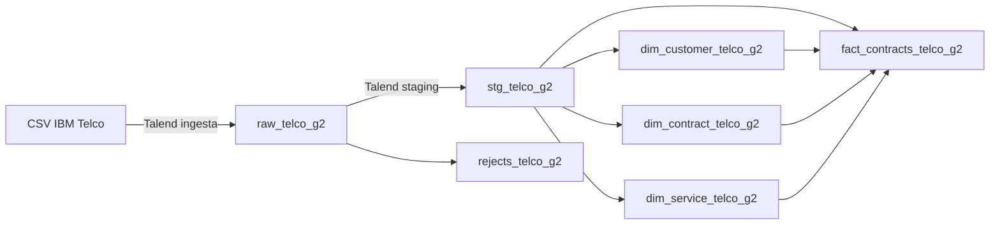

# 📱 Datatón Genius Lab III: IBM Telco Churn
> **Segmentación de clientes en riesgo de abandono y recomendador de acciones de retención.**  
> *5 días · 5 industrias · 1 producto de datos*

---

## 🎯 1. Problema de Negocio

Una empresa de telecomunicaciones enfrenta una tasa de abandono de clientes (**churn**) cercana al **26.5%**, lo que impacta significativamente en los ingresos recurrentes y en el costo de adquisición de nuevos usuarios.

### Preguntas clave a resolver:
1. **¿Qué segmentos de clientes tienen mayor propensión al abandono?** (Identificación de factores de riesgo demográficos, de servicio y contractuales).
2. **¿Qué acción de retención personalizada conviene aplicar a cada segmento?** (Estrategias focalizadas según impacto en margen y lealtad).

### 🌟 KPI Estrella
* **% de reducción de churn esperada por segmento** tras la implementación de las estrategias de retención recomendadas.

---

## 👥 2. Equipo de Trabajo

| Rol | Responsable | Entregable Clave | Perfil / Foco |
|---|---|---|---|
| 🏗 **Data Engineer** | *(Por asignar)* | Pipeline Talend funcional end-to-end: CSV → SingleStore → Snowflake | Jobs de Talend, conexiones, transformaciones tMap y debugging |
| 📊 **Data Analyst** | *(Por asignar)* | Modelo analítico en SingleStore/Snowflake, segmentación, recomendador y dashboard en Tableau | Queries SQL, vistas, métricas de retención y storytelling |
| ✅ **Data Steward** | *(Por asignar)* | Catálogo, reporte DQ (mínimo 5 reglas) y linaje documentado en OpenMetadata | Definición de umbrales, validación de reglas DQ y gobernanza |
| 🎤 **Presentador / PM** | *(Por asignar)* | Gestión de backlog, README, control de commits y Deck de presentación para Demo Day | Coordinación de standups, deck de 10 min y visión de negocio |

### 🔐 Seguridad y Accesos en Snowflake

* **Identificador de Cuenta (Servidor):** `xbbiurh-el04715`
* **URL de Ingreso:** `https://app.snowflake.com/xbbiurh/el04715`
* **Base de Datos:** `TELCO_G2`
* **Esquema:** `analytics`
* **Warehouse:** `COMPUTE_WH`

| Usuario Snowflake | Rol Asignado | Nivel de Privilegio | Propósito en el Proyecto |
|---|---|---|---|
| `engineer_telco` | `TELCO_WRITER` | Lectura / Escritura (`USAGE`, `CREATE TABLE`, `INSERT`, `UPDATE`) | Ejecución de Pipelines ETL/ELT e ingesta de datos |
| `steward_telco` | `TELCO_READER` | Lectura (`USAGE`, `SELECT`) | Gobernanza, perfilado DQ y auditoría |
| `analyst_telco` | `TELCO_READER` | Lectura (`USAGE`, `SELECT`) | Consultas analíticas, modelado y alimentación de Tableau |

---

## 📊 3. Dataset

* **Fuente:** [IBM Telco Customer Churn (IBM Developer / Kaggle)](https://www.kaggle.com/datasets/blastchar/telco-customer-churn)
* **Volumen de origen:** 7.043 clientes | 21 variables en el CSV.
* **Tabla raw:** `raw_telco_g2`, con 22 columnas: las 21 originales más `fecha_carga`.
* **Target:** `Churn` (Yes / No) — Tasa base de desbalance: **~26.5%**

### Variables Clave
* **Identificador:** `customerID`
* **Datos Demográficos:** `gender`, `SeniorCitizen`, `Partner`, `Dependents`
* **Servicios Contratados:** `PhoneService`, `MultipleLines`, `InternetService`, `OnlineSecurity`, `OnlineBackup`, `DeviceProtection`, `TechSupport`, `StreamingTV`, `StreamingMovies`
* **Información Contractual:** `tenure`, `Contract` (Mes a mes, 1 año, 2 años), `PaperlessBilling`, `PaymentMethod`
* **Facturación:** `MonthlyCharges`, `TotalCharges`
* **Estado:** `Churn`

> [!WARNING]
> **Problema de Calidad Conocido:**  
> La columna `TotalCharges` presenta **11 registros en blanco** correspondientes a clientes con `tenure = 0` (nuevos usuarios sin historial de facturación). Se conservan sin modificar en raw. DQ-02 detecta y documenta los blancos; la imputación a `0.00` cuando `tenure = 0` corresponde a la transformación posterior.

---

## 🏗 4. Arquitectura de Datos

### Flujo implementado en SingleStore Cloud

El entorno actual es la base **telco_g2** de SingleStore Cloud. DSADEV fue el entorno del diagnóstico inicial y sus evidencias se conservan con esa identificación.



El equipo ejecutó los jobs de ingesta, staging y modelo y reportó sus validaciones aprobadas. Los conteos de aceptación del modelo son 7.043 clientes, 24 combinaciones de contrato, 322 perfiles de servicios y 7.043 hechos. Los jobs de validación y [la consulta SQL del modelo](sql/12_validacion_modelo_cloud.sql) permiten comprobarlos sin repetir cargas.

La [evidencia de comparación raw → staging](docs/data_quality/2026-11-06_raw_vs_staging_11_imputaciones.png) muestra 11 espacios originales conservados, todos con tenure=0, y sus valores tratados en cero con marca y motivo. OpenMetadata cataloga las siete tablas y documenta [nueve relaciones de linaje](docs/lineage/2026-11-06_linaje_singlestore_cloud.md). En staging hay [cinco casos DQ aprobados](docs/data_quality/2026-11-06_reporte_dq_staging_cloud.md).

**Grano de hechos.** Una fila por cliente en la fotografía del dataset. El maestro encadena los jobs desde el CSV hasta Snowflake. El equipo tiene pendiente probar su ejecución desde Talend Management Console (TMC).

### Tramo de Snowflake

El equipo incorporó los scripts de [creación de tablas](sql/Snowflake/creacion_tablas_modelos_snowflake.sql) y [roles y permisos](sql/Snowflake/roles_y_permisos_snowflake.sql) para TELCO_G2.ANALYTICS. Definen raw, staging, rechazos, tres dimensiones y hechos. Las tres dimensiones declaran claves IDENTITY; al cargar hechos deben resolverse o conservarse las correspondencias de claves de manera consistente.

Los nombres de tabla entre comillas dobles están definidos en minúsculas. Respetar los identificadores del DDL y los ajustes del conector; no asumir que todos los nombres de columna tienen el mismo uso de mayúsculas que las tablas.

El 7 de noviembre, el maestro escribió las tres dimensiones y la tabla de hechos en Snowflake. La conciliación posterior devolvió cero diferencias, con 7.043 hechos, 1.869 abandonos, 11 imputaciones y cero huérfanos. [Evidencia de la ejecución](docs/catalogo/jobs_modelo_cloud.md#transferencia-a-snowflake).

---

## 📁 5. Estructura del Repositorio

```text
data/telco_churn.csv                         # Fuente original
IBM_TELCO_CHURN/process/Proyecto_Telco/       # Jobs nativos, maestro y transferencia
talend_jobs/job_telco_ingesta.zip            # Export inicial; no contiene todos los jobs actuales
sql/01_ddl_raw_singlestore.sql               # DDL raw del entorno inicial
sql/02_dq_auditoria_calidad.sql              # Auditoría raw histórica (DSADEV)
sql/07_perfilado_completo_raw_telco.sql      # Perfilado raw histórico
sql/08_validacion_categorias_y_servicios.sql # Dominios y coherencia históricos
sql/cloud/                                 # Mismos controles raw, adaptados a telco_g2
sql/10_ddl_staging_cloud.sql                # Referencia de staging/rechazos
sql/11_ddl_modelo_cloud.sql                 # Referencia del modelo Cloud
sql/12_validacion_modelo_cloud.sql          # Conciliación del modelo, solo lectura
sql/Snowflake/                             # DDL y permisos aportados por el equipo
docs/backlog.md                            # Estado de tareas y evidencias
docs/catalogo/                             # Diccionario y documentación de jobs
docs/data_quality/                         # Diagnóstico raw y validación de staging
docs/lineage/                              # Grafos históricos y grafo Cloud actual
```

La [consulta de segmentación](sql/05_segmentation.sql) y el [recomendador propuesto](sql/06_recomendador_retencion.sql) se ejecutaron en Cloud. El [reporte con seis capturas](docs/analisis/2026-11-06_segmentacion_y_retencion_cloud.md) documenta nueve cruces contrato/servicio, cuatro grupos estratégicos, las acciones y tres escenarios de impacto. La [guía de análisis](docs/catalogo/segmentacion_y_recomendador.md) explica las métricas y la propuesta de auditoría con dim_fecha. La matriz es un resultado SQL; no se creó una tabla física o vista con estas consultas.

---

## 🛠 6. Ejecución y verificación

### Prerrequisitos

- Talend Studio compatible con los jobs. Importar desde la carpeta IBM_TELCO_CHURN del clon actualizado, que contiene talend.project. Incluir `telco_context 0.1` y los jobs de Proyecto_Telco.
- Conexión autorizada a SingleStore Cloud, base telco_g2 y puerto 3333. Las credenciales se configuran en Talend y no se incluyen en Git.
- Ruta local al CSV configurada para la ingesta.
- OpenMetadata disponible en localhost:8585, con servicio SingleStore_Cloud_Telco_G2, certificado CA y acceso a telco_g2. Para ejecutar ingesta y DQ deben estar activos sus servicios de soporte.
- Acceso a Snowflake con `TELCO_WRITER` para publicar el modelo desde el maestro. Para incluir la conciliación con Snowflake en la validación, completar también `snowflake_password` en Run.

### Ejecutar el maestro

En **Run → Basic Run**, selecciona el perfil de `job_telco_pipeline_maestro`. Configura las conexiones en Talend y usa la ruta local del CSV en la primera carga.

| Perfil | Modo | Cuándo usarlo |
|---|---|---|
| `Default` | `carga_inicial` | Construye el modelo desde el CSV y lo publica en Snowflake. Las siete tablas de carga de SingleStore deben existir y estar vacías. |
| `Validacion` | `validar` | Comprueba la carga existente en SingleStore y, con contraseña de Snowflake, concilia las cuatro tablas publicadas. |

### Primera carga en un entorno nuevo

1. Crear raw en la base del entorno y revisar los tipos: MonthlyCharges y TotalCharges son VARCHAR(20), sin imputar; fecha_carga es un metadato técnico.
2. Ejecutar job_telco_ingesta una sola vez. Verificar 7.043 filas, 7.043 IDs distintos, cero NULL y 11 blancos en TotalCharges.
3. Ejecutar job_telco_staging. Crea staging y rechazos si no existen, requiere destinos vacíos, valida los datos y convierte los importes a DECIMAL. Solo imputa blanco con tenure=0 y conserva originales, marca y motivo.
4. Ejecutar job_telco_validar_staging. El criterio del CSV es 7.043 aceptados, cero rechazados y 11 imputaciones correctas.
5. Ejecutar job_telco_modelo_dimensional. Crea los cuatro destinos si no existen y requiere que estén vacíos. Carga clientes, contratos y servicios; valida las correspondencias y después carga hechos.
6. Ejecutar job_telco_validar_modelo. Verifica los conteos y compara relaciones, medidas y trazabilidad con staging.

Las [guías de staging](docs/catalogo/jobs_staging_cloud.md) y [modelo](docs/catalogo/jobs_modelo_cloud.md) describen los controles. El DDL de referencia no sustituye la revisión del entorno de destino. Los SQL originales con DSADEV se conservan para el historial; no ejecutarlos sin adaptar la base.

### Revisar una base ya cargada

Ejecutar únicamente los validadores o las consultas de solo lectura. No repetir ingesta para revisar un commit: raw no tiene una clave única que evite duplicados. Staging y modelo tienen protecciones de carga inicial, pero no constituyen un proceso incremental ni una única transacción; un fallo parcial requiere revisar el estado antes de recuperar. No usar DROP/TRUNCATE como reintento automático.

Para repetir el análisis raw en Cloud, usar sql/cloud/ por sentencias; las adaptaciones cambian el destino, no las reglas. No se documenta una nueva ejecución de esos bloques hasta contar con sus resultados.

### Catálogo, calidad y orquestación

El catálogo Cloud contiene siete tablas descritas y nueve relaciones manuales. Ejecutar la tubería DQ de staging bajo demanda y guardar la evidencia fechada de sus cinco pruebas. La falta de acceso a mysql.general_log impide obtener ese linaje del historial de consultas, pero no impide catalogar tablas ni ejecutar las pruebas DQ autorizadas.

El maestro ya se probó en Studio. El equipo debe publicar la tarea en TMC, ejecutarla con `Validacion` y guardar el log. El [libro de Tableau](docs/dashboard/telco_g2_dashboard.twb) incluye la conexión a Snowflake. Una integrante del equipo reportó haber probado esa conexión para la demo.

---

## 🛡️ 7. Calidad de Datos

### Evidencia actual de staging en Cloud

El 6 de noviembre OpenMetadata registró **5 pruebas exitosas, 0 fallidas y 0 abortadas**: customerID único, customerID sin NULL, MonthlyCharges entre 18 y 120, TotalCharges sin NULL e imputaciones correctas. El control SQL de imputaciones comprueba exactamente 11 marcas y sus condiciones de negocio.

**5/5 representa aprobación de estos controles, no calidad global del 100%.** [Reporte y capturas de staging](docs/data_quality/2026-11-06_reporte_dq_staging_cloud.md).

### Diagnóstico inicial de raw que se conserva

Raw conserva los problemas de la fuente para medirlos; su tratamiento pertenece a la capa posterior.

| Regla | Control | Resultado inicial observado |
|---|---|---|
| DQ-01a/b | customerID completo y único | 7.043 IDs distintos; cero NULL o blancos |
| DQ-02a | TotalCharges sin NULL | Cero NULL |
| DQ-02b | TotalCharges sin blancos | 11 blancos conocidos; completitud 99,84% |
| DQ-03 | Formato numérico y rango inclusivo 18–120 de MonthlyCharges | Sin formato inválido ni valores fuera del intervalo |
| DQ-04 | Contract en su dominio | Categorías válidas |
| DQ-05 | Churn en Yes/No | Categorías válidas |

La ejecución histórica de OpenMetadata a las 16:57 del 5 de noviembre, en el servicio del entorno DSADEV, mostró **6 pruebas exitosas y 1 fallida** por los blancos de raw. La proporción de pruebas aprobadas (85,71%) es distinta de la completitud de TotalCharges (99,84%). No se declara una calidad global de 100%.

Los controles SQL adicionales verificaron 17 dominios sin valores inválidos o nulos y siete relaciones entre servicios sin inconsistencias, sobre 7.043 filas cada uno. Son controles SQL; no se contabilizan como nuevos casos de OpenMetadata.

**Criterio de rango documentado:** 18–120 inclusivo. El perfilado comparó también 18–125 y ambos pasan en este archivo; la auditoría de este repositorio se alinea con el criterio de README/OpenMetadata.

**Meta global:** ≥99%, cuya fórmula de agregación debe acordarse antes de certificar el conjunto. Los fallos conocidos de raw se reportan y no se ocultan mediante imputación en el origen.

- [Resumen DQ](docs/data_quality/dq_report.md).
- [Pruebas iniciales de OpenMetadata](docs/data_quality/2026-11-05_reporte_dq_inicial.md).
- [Perfilado, dominios, coherencia y exploración con evidencias](docs/data_quality/2026-11-05_perfilado_y_exploracion_raw.md).
- [Diccionario de las siete tablas del pipeline y sus 107 columnas](docs/catalogo/diccionario_datos_telco.md); el calendario se documenta en la guía de análisis.
- [Acuerdos iniciales de tratamiento](docs/catalogo/reglas_staging_y_acuerdos.md); la implementación actual se documenta en las guías de los jobs.
- [Linaje actual en Cloud](docs/lineage/2026-11-06_linaje_singlestore_cloud.md) y [antecedente DSADEV](docs/lineage/lineage_report.md). La transferencia a Snowflake se documentó con el log del maestro.

---
## 📊 8. Dashboard y Visualizaciones en Tableau Cloud

* **Enlace directo al Dashboard:** [Ver Tablero en Tableau Cloud](https://10ax.online.tableau.com/#/site/telco_grupo_2/projects/2456145?:origin=card_share_link)[cite: 6]
* **Infraestructura:** Tableau Developer Sandbox (`telco_grupo_2`) conectado directamente al esquema analítico de Snowflake (`TELCO_G2.ANALYTICS`)[cite: 6].

### Componentes de la Interfaz:
* **Panorama del Churn:** Métricas globales de clientes, abandonos totales, churn global y comportamiento por segmentos estratégicos (`SEG-01` a `SEG-04`).
* **Filtros y Simulador de Escenarios:** Parámetro interactivo de escenarios (`Conservador`, `Central`, `Optimista`) que calcula dinámicamente la reducción de churn e impactos económicos equivalentes.
* **Matriz de Recomendaciones:** Tabla interactiva con acciones comerciales, canales de contacto e incentivos propuestos por segmento.

---

## 🔮 9. Hallazgos y Próximos Pasos

### Hallazgos Preliminares:
* **Mes a mes + fibra:** 2.128 clientes, 1.162 con abandono, tasa histórica de 54,61%. Es una asociación descriptiva, no una estimación de efecto causal.
* Los nueve segmentos por contrato e Internet suman 7.043 clientes y 1.869 abandonos (26,54%). El análisis por antigüedad tiene consultas preparadas; sus resultados deben incorporarse con evidencia al ejecutarlas.
* En el modelo Cloud, mes a mes + servicio Basico agrupa 2.165 clientes y 1.185 abandonos: churn 54,73%, concentrando el 63,40% de los abandonos. Este cruce contrato/servicio es distinto del cruce contrato/tecnología de Internet anterior.
* El escenario central propuesto produciría churn 22,57%, frente a 26,54% histórico: reducción relativa 14,94% o 3,96 puntos porcentuales, equivalente a 279,19 abandonos menos sobre una población comparable. Es una proyección basada en supuestos de eficacia por grupo, no una reducción observada. [Resultados y fórmulas](docs/analisis/2026-11-06_segmentacion_y_retencion_cloud.md).

### Próximos Pasos (Roadmap):
* [x] Probar el pipeline completo en Talend Studio y conciliar la carga en Snowflake.
* [ ] Publicar y probar la tarea en TMC.
* [x] Ejecutar el análisis por contrato y nivel de servicio y la matriz SQL de acciones sobre cuatro grupos estratégicos complementarios. Las proyecciones son escenarios explícitos, no efectos medidos ni LTV observado.
* [x] Publicar el libro de trabajo en Tableau Cloud (`telco_grupo_2`) y configurar accesos de equipo..
* [ ] Preparar el deck y ensayar la demo del dashboard de Tableau.


### Modelo predictivo de demostración

El [script de clasificación](sql/Snowflake/entrenar_churn_demo.sql) prepara `TELCO_G2.ANALYTICS.TELCO_CHURN_DEMO_V1` desde el modelo dimensional. Se ejecuta en Snowsight, en una sola sesión, con `TELCO_WRITER`. Si el rol no tiene permiso de creación de modelos, un administrador puede ejecutar el `GRANT` indicado en el script.

El 8 de noviembre se entrenó el modelo en Snowflake con 5.636 clientes y se evaluó con otros 1.407. La exactitud fue **80,67 %**, frente al **73,49 %** de predecir permanencia para todos. El modelo detectó **213 de 373 abandonos** (recall de 57,10 %). Generó 325 alertas, de las cuales 112 fueron falsas (precisión de 65,54 %). El F1 para abandono fue **0,610**.

La evaluación mide el desempeño en una muestra histórica. Para estimar el riesgo futuro harían falta datos con fechas y una validación en un período posterior. La reducción de churn se mediría con una campaña de retención y un grupo de comparación.

---

## 🗓 10. Cronograma y Sprints

| Día | Hito / Sprint | Foco Principal | Entregables Clave |
|---|---|---|---|
| **Mié 4 Nov** | **Kickoff (Sesión 17)** | Elección de industria, conformación de equipo, clonado de repo, definición de roles y backlog | Repo inicializado + README borrador + [Backlog](docs/backlog.md) |
| **Jue 5 Nov** | **Sprint 1** | Ingesta de datos en Talend, exploración EDA, perfilado DQ y modelo base en SingleStore | Pipeline de ingesta funcional + DDL SingleStore |
| **Vie 6 Nov** | **Sprint 2** | Transformaciones ELT hacia Snowflake, reglas DQ activas, linaje en catálogo y prototipo de dashboard | Pipeline end-to-end + Catálogo OpenMetadata + Dashboard preliminar |
| **Lun 9 Nov** | **Demo Day** | Presentación de 10 min + 5 min de preguntas y demo en vivo | Deck + demo del pipeline o dashboard |
| **Mar 10 Nov** | **Cierre** | Retroalimentación, lecciones aprendidas y cierre del Genius Lab | README final en el repositorio |

---

## 🏆 11. Criterios de Evaluación del Datatón

Para asegurar la máxima puntuación en la evaluación técnica y de negocio:

* **Repositorio Git (20%):** Estructura ordenada (`/data`, `/talend_jobs`, `/sql`, `/docs`), commits frecuentes (mínimo 1 commit diario por integrante).
* **Pipeline Funcional (25%):** Flujo Ingesta → Transformación → SingleStore → Snowflake ejecutable y documentado.
* **Calidad de Datos (20%):** Mínimo 5 reglas DQ activas, reporte de calidad documentado con umbral medido (meta ≥ 99%).
* **Linaje en Catálogo (15%):** Datasets documentados y al menos 3 assets con linaje fuente → destino en OpenMetadata.
* **Presentación Demo Day (20%):** Presentación clara de 10 min enfocada en negocio, arquitectura, KPI estrella y demo en vivo.

