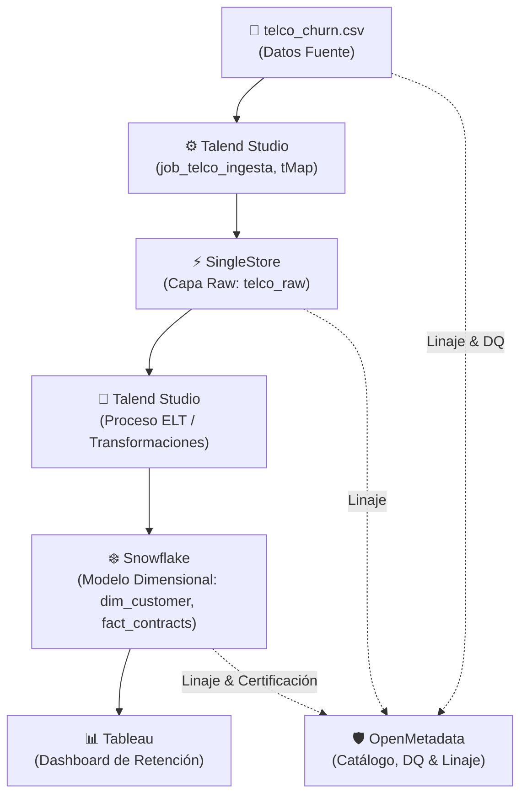

# 📱 Datatón Genius Lab III: IBM Telco Churn
> **Segmentación de clientes en riesgo de abandono y recomendador de acciones de retención.**  
> *5 días · 5 industrias · 1 producto de datos*

---

## 🎯 1. Problema de Negocio

Una empresa de telecomunicaciones enfrenta una tasa de abandono de clientes (**churn**) cercana al **26.5%**, lo que impacta significativamente en los ingresos recurrentes y en el costo de adquisición de nuevos usuarios.

### Preguntas clave a resolver:
1. **¿Qué segmentos de clientes tienen mayor propensión al abandono?** (Identificación de factores de riesgo demográficos, de servicio y contractuales).
2. **¿Qué acción de retención personalizada conviene aplicar a cada segmento?** (Estrategias focalizadas según impacto en margen y lealtad).

### 🌟 KPI Estrella
* **% de reducción de churn esperada por segmento** tras la implementación de las estrategias de retención recomendadas.

---

## 👥 2. Equipo de Trabajo

| Rol | Responsable | Entregable Clave | Perfil / Foco |
|---|---|---|---|
| 🏗 **Data Engineer** | *(Por asignar)* | Pipeline Talend funcional end-to-end: CSV → SingleStore → Snowflake | Jobs de Talend, conexiones, transformaciones tMap y debugging |
| 📊 **Data Analyst** | *(Por asignar)* | Modelo analítico en SingleStore/Snowflake, segmentación, recomendador y dashboard en Tableau | Queries SQL, vistas, métricas de retención y storytelling |
| ✅ **Data Steward** | *(Por asignar)* | Catálogo, reporte DQ (mínimo 5 reglas) y linaje documentado en OpenMetadata | Definición de umbrales, validación de reglas DQ y gobernanza |
| 🎤 **Presentador / PM** | *(Por asignar)* | Gestión de backlog, README, control de commits y Deck de presentación para Demo Day | Coordinación de standups, deck de 10 min y visión de negocio |

---

## 📊 3. Dataset

* **Fuente:** [IBM Telco Customer Churn (IBM Developer / Kaggle)](https://www.kaggle.com/datasets/blastchar/telco-customer-churn)
* **Volumen:** 7,043 clientes | 21 variables
* **Target:** `Churn` (Yes / No) — Tasa base de desbalance: **~26.5%**

### Variables Clave
* **Identificador:** `customerID`
* **Datos Demográficos:** `gender`, `SeniorCitizen`, `Partner`, `Dependents`
* **Servicios Contratados:** `PhoneService`, `MultipleLines`, `InternetService`, `OnlineSecurity`, `OnlineBackup`, `DeviceProtection`, `TechSupport`, `StreamingTV`, `StreamingMovies`
* **Información Contractual:** `tenure`, `Contract` (Mes a mes, 1 año, 2 años), `PaperlessBilling`, `PaymentMethod`
* **Facturación:** `MonthlyCharges`, `TotalCharges`
* **Estado:** `Churn`

> [!WARNING]
> **Problema de Calidad Conocido:**  
> La columna `TotalCharges` presenta **11 registros en blanco** correspondientes a clientes con `tenure = 0` (nuevos usuarios sin historial de facturación). Se gestionará mediante la regla de calidad DQ-02 (imputación a `0.00`).

---

## 🏗 4. Arquitectura de Datos

El producto de datos sigue un flujo desacoplado, escalable y gobernado:



### Componentes:
1. **Ingesta:** Talend Studio lee el archivo CSV origen y realiza el mapeo y tipado (`tMap`).
2. **Landing / Raw:** Base de datos SingleStore (`telco_raw`) para almacenamiento columnar de alta velocidad.
3. **Transformación & Data Warehouse:** Proceso ELT hacia Snowflake generando el modelo dimensional (`dim_customer`, `fact_contracts`).
4. **Capa de Consumo Analítico:** Dashboard interactivo en Tableau enfocado en segmentación y recomendador.
5. **Gobernanza de Datos:** OpenMetadata para registro de metadatos, linaje de al menos 3 assets (fuente → destino) y monitoreo de reglas de calidad.

---

## 📁 5. Estructura del Repositorio

```text
datathon-telco-churn/
│
├── data/                  # Datasets de origen y muestras de prueba
│   └── telco_churn.csv    # Dataset base IBM Telco (~7K registros)
│
├── talend_jobs/           # Jobs de Talend Studio exportados (.zip / items)
│   └── job_telco_ingesta/ # Job de ingesta y transformaciones tMap
│
├── sql/                   # Scripts SQL versionados
│   ├── 01_ddl_singlestore.sql # DDL para la capa raw en SingleStore
│   ├── 02_snowflake_model.sql # Modelo dimensional (dim_customer, fact_contracts)
│   └── 03_segmentation.sql    # Lógica de segmentación y recomendador
│
├── docs/                  # Documentación, diagramas, backlog y reportes
│   ├── backlog.md         # Backlog ágil de tareas por sprint
│   └── data_quality/      # Reportes de calidad y evidencias OpenMetadata
│
├── .gitignore             # Exclusiones de control de versiones
└── README.md              # Documentación principal del proyecto
```

---

## 🛠 6. Cómo Ejecutar el Pipeline

> [!NOTE]
> *Instrucciones en construcción. Se completarán en el Sprint 2 (Viernes 6 de Noviembre) con la integración end-to-end.*

### Prerrequisitos:
* Talend Open Studio for Data Integration (v8.x o superior).
* Instancia activa y credenciales de acceso a **SingleStore**.
* Almacén de datos configurado en **Snowflake**.
* Plataforma **OpenMetadata** con conectores activos.
* **Tableau Desktop / Public** para visualización.

### Pasos de Ejecución (Resumen):
1. **Configurar Contextos:** Importar variables de entorno en Talend (`db_host`, `db_user`, `db_password`).
2. **Ejecutar Ingesta Raw:** Correr `job_telco_ingesta` en Talend para cargar `data/telco_churn.csv` en SingleStore.
3. **Ejecutar Modelo ELT:** Ejecutar scripts de transformación dimensional en Snowflake.
4. **Validar Linaje y DQ:** Disparar escaneo de metadatos y validación de tests en OpenMetadata.
5. **Actualizar Dashboard:** Conectar Tableau a Snowflake para visualizar segmentos y acciones recomendadas.

---

## 🛡️ 7. Calidad de Datos (Data Quality - DQ)

**Umbral de Calidad Acordado:** **≥ 99% de conformidad global**.

Se implementan como mínimo 5 reglas activas documentadas y auditadas en OpenMetadata:

| ID Regla | Campo Evaluado | Dimensión DQ | Regla / Validación | Acción ante Falla |
|---|---|---|---|---|
| **DQ-01** | `customerID` | **Unicidad** | Clave primaria sin duplicados ni nulos (`COUNT(DISTINCT) = COUNT(*)`) | Rechazar / Alerta crítica |
| **DQ-02** | `TotalCharges` | **Completitud** | Tratamiento de 11 registros en blanco cuando `tenure = 0` | Imputar con `0.00` |
| **DQ-03** | `MonthlyCharges` | **Rango** | Valor numérico positivo estrictamente en el rango `[18.00, 120.00]` | Marcar registro anómalo |
| **DQ-04** | `Contract` | **Validez / Formato** | Pertenencia al conjunto de valores permitidos: `'Month-to-month'`, `'One year'`, `'Two year'` | Enviar a tabla de excepciones |
| **DQ-05** | `Churn` | **Consistencia** | Variable objetivo binaria únicamente con valores `'Yes'` o `'No'` | Alerta de integridad |

* **Linaje Registrado:** Mínimo 3 assets con linaje verificado (`CSV Fuente` → `SingleStore telco_raw` → `Snowflake dim/fact`).

---

## 🔮 8. Hallazgos y Próximos Pasos

### Hallazgos Preliminares:
* Clientes con contratos de tipo **mes a mes (Month-to-month)** y servicios de fibra óptica muestran la mayor tasa relativa de deserción.
* La permanencia (`tenure`) en los primeros 12 meses es el periodo más crítico de abandono.

### Próximos Pasos (Roadmap):
* [ ] Finalizar el despliegue del pipeline ELT automatizado.
* [ ] Implementar la matriz de recomendaciones según valor del cliente (*LTV*) y nivel de riesgo.
* [ ] Publicar dashboard final en Tableau con visualización de impacto económico.

---

## 🗓 9. Cronograma y Sprints

| Día | Hito / Sprint | Foco Principal | Entregables Clave |
|---|---|---|---|
| **Mié 4 Nov** | **Kickoff (Sesión 17)** | Elección de industria, conformación de equipo, clonado de repo, definición de roles y backlog | Repo inicializado + README borrador + [Backlog](docs/backlog.md) |
| **Jue 5 Nov** | **Sprint 1** | Ingesta de datos en Talend, exploración EDA, perfilado DQ y modelo base en SingleStore | Pipeline de ingesta funcional + DDL SingleStore |
| **Vie 6 Nov** | **Sprint 2** | Transformaciones ELT hacia Snowflake, reglas DQ activas, linaje en catálogo y prototipo de dashboard | Pipeline end-to-end + Catálogo OpenMetadata + Dashboard preliminar |
| **Lun 9 Nov** | **Ensayo y Pulido** | Integración final, cálculo del KPI estrella, estructuración del deck y ensayo general (10 min) | Deck de presentación + Demo ensayada |
| **Mar 10 Nov** | **Demo Day / Cierre** | Presentación final (10 min + 5 min Q&A), retroalimentación y cierre del Genius Lab | Presentación en vivo + README final certificado |

---

## 🏆 10. Criterios de Evaluación del Datatón

Para asegurar la máxima puntuación en la evaluación técnica y de negocio:

* **Repositorio Git (20%):** Estructura ordenada (`/data`, `/talend_jobs`, `/sql`, `/docs`), commits frecuentes (mínimo 1 commit diario por integrante).
* **Pipeline Funcional (25%):** Flujo Ingesta → Transformación → SingleStore → Snowflake ejecutable y documentado.
* **Calidad de Datos (20%):** Mínimo 5 reglas DQ activas, reporte de calidad documentado con umbral medido (meta ≥ 99%).
* **Linaje en Catálogo (15%):** Datasets documentados y al menos 3 assets con linaje fuente → destino en OpenMetadata.
* **Presentación Demo Day (20%):** Presentación clara de 10 min enfocada en negocio, arquitectura, KPI estrella y demo en vivo.
