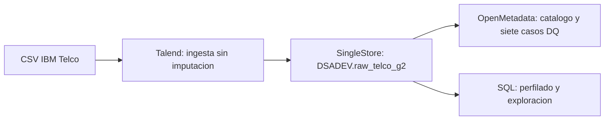
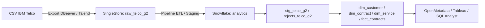

# 📱 Datatón Genius Lab III: IBM Telco Churn
> **Segmentación de clientes en riesgo de abandono y recomendador de acciones de retención.**  
> *5 días · 5 industrias · 1 producto de datos*

---

## 🎯 1. Problema de Negocio

Una empresa de telecomunicaciones enfrenta una tasa de abandono de clientes (**churn**) cercana al **26.5%**, lo que impacta significativamente en los ingresos recurrentes y en el costo de adquisición de nuevos usuarios.

### Preguntas clave a resolver:
1. **¿Qué segmentos de clientes tienen mayor propensión al abandono?** (Identificación de factores de riesgo demográficos, de servicio y contractuales).
2. **¿Qué acción de retención personalizada conviene aplicar a cada segmento?** (Estrategias focalizadas según impacto en margen y lealtad).

### 🌟 KPI Estrella
* **% de reducción de churn esperada por segmento** tras la implementación de las estrategias de retención recomendadas.

---

## 👥 2. Equipo de Trabajo

| Rol | Responsable | Entregable Clave | Perfil / Foco |
|---|---|---|---|
| 🏗 **Data Engineer** | *(Por asignar)* | Pipeline Talend funcional end-to-end: CSV → SingleStore → Snowflake | Jobs de Talend, conexiones, transformaciones tMap y debugging |
| 📊 **Data Analyst** | *(Por asignar)* | Modelo analítico en SingleStore/Snowflake, segmentación, recomendador y dashboard en Tableau | Queries SQL, vistas, métricas de retención y storytelling |
| ✅ **Data Steward** | *(Por asignar)* | Catálogo, reporte DQ (mínimo 5 reglas) y linaje documentado en OpenMetadata | Definición de umbrales, validación de reglas DQ y gobernanza |
| 🎤 **Presentador / PM** | *(Por asignar)* | Gestión de backlog, README, control de commits y Deck de presentación para Demo Day | Coordinación de standups, deck de 10 min y visión de negocio |

### 🔐 Seguridad y Accesos en Snowflake

* **Identificador de Cuenta (Servidor):** `xbbiurh-el04715`
* **URL de Ingreso:** `https://app.snowflake.com/xbbiurh/el04715`
* **Base de Datos:** `TELCO_G2`
* **Esquema:** `analytics`
* **Warehouse:** `COMPUTE_WH`

| Usuario Snowflake | Rol Asignado | Nivel de Privilegio | Propósito en el Proyecto |
|---|---|---|---|
| `engineer_telco` | `TELCO_WRITER` | Lectura / Escritura (`USAGE`, `CREATE TABLE`, `INSERT`, `UPDATE`) | Ejecución de Pipelines ETL/ELT e ingesta de datos |
| `steward_telco` | `TELCO_READER` | Lectura (`USAGE`, `SELECT`) | Gobernanza, perfilado DQ y auditoría |
| `analyst_telco` | `TELCO_READER` | Lectura (`USAGE`, `SELECT`) | Consultas analíticas, modelado y alimentación de Tableau |

---

## 📊 3. Dataset

* **Fuente:** [IBM Telco Customer Churn (IBM Developer / Kaggle)](https://www.kaggle.com/datasets/blastchar/telco-customer-churn)
* **Volumen de origen:** 7.043 clientes | 21 variables en el CSV.
* **Tabla raw:** `raw_telco_g2`, con 22 columnas: las 21 originales más `fecha_carga`.
* **Target:** `Churn` (Yes / No) — Tasa base de desbalance: **~26.5%**

### Variables Clave
* **Identificador:** `customerID`
* **Datos Demográficos:** `gender`, `SeniorCitizen`, `Partner`, `Dependents`
* **Servicios Contratados:** `PhoneService`, `MultipleLines`, `InternetService`, `OnlineSecurity`, `OnlineBackup`, `DeviceProtection`, `TechSupport`, `StreamingTV`, `StreamingMovies`
* **Información Contractual:** `tenure`, `Contract` (Mes a mes, 1 año, 2 años), `PaperlessBilling`, `PaymentMethod`
* **Facturación:** `MonthlyCharges`, `TotalCharges`
* **Estado:** `Churn`

> [!WARNING]
> **Problema de Calidad Conocido:**  
> La columna `TotalCharges` presenta **11 registros en blanco** correspondientes a clientes con `tenure = 0` (nuevos usuarios sin historial de facturación). Se conservan sin modificar en raw. DQ-02 detecta y documenta los blancos; la imputación a `0.00` cuando `tenure = 0` corresponde a la transformación posterior.

---

## 🏗 4. Arquitectura de Datos

### Flujo implementado y evidencia disponible para SingleStore



La ingesta raw está respaldada por 7.043 filas, conservación de 11 blancos y resultados SQL/DQ. El modelo dimensional está definido en SingleStore mediante tres dimensiones y una tabla de hechos. En el último conteo compartido esas cuatro tablas estaban vacías: su poblado y validación son un paso posterior.

El script `sql/04_poblado_modelo_dimensional.sql` describe el flujo directo de raw al modelo dimensional en SingleStore. No hay una tabla staging física de Telco en los archivos revisados; el tratamiento debe documentarse en esa transformación o en una capa separada si el equipo la incorpora.

El [reporte de linaje](docs/lineage/lineage_report.md) documenta cinco activos conectados dentro de SingleStore: raw y las cuatro tablas dimensionales/de hechos. Ese grafo no certifica que los destinos estén poblados ni que el tramo hacia Snowflake esté implementado.

### Destino previsto

La infraestructura se compone de **SingleStore (gestión inicial)** para la ingesta raw y perfilado rápido, conectada hacia **Snowflake (Data Warehouse final)** para albergar las capas Staging, Rejections y el Modelo Dimensional estrella en minúsculas para compatibilidad con Talend/DBeaver.



### Definición del Snowflake (`telco_g2.analytics`)
Para evitar conflictos de sensibilidad de mayúsculas/minúsculas entre DBeave/Talend y Snowflake, **todas las tablas han sido creadas con comillas dobles `""` en minúsculas** y llaves primarias `IDENTITY(1,1)`:

1. `"raw_telco_g2"`: Ingesta en crudo.
2. `"rejects_telco_g2"`: Captura de anomalías y motivos de rechazo (`reject_reason`).
3. `"stg_telco_g2"`: Datos tipados (`NUMBER(8,2)`), limpios e imputados.
4. `"dim_contract_telco_g2"`: Dimensión contractual (`contract_key`).
5. `"dim_customer_telco_g2"`: Dimensión demográfica (`customer_key`).
6. `"dim_service_telco_g2"`: Dimensión de servicios (`service_key`).
7. `"fact_contracts_telco_g2"`: Tabla de hechos agregada.

---

## 📁 5. Estructura del Repositorio

```text
data/telco_churn.csv                         # Fuente original
talend_jobs/job_telco_ingesta.zip            # Export de ingesta
sql/01_ddl_raw_singlestore.sql               # DDL raw de referencia
sql/02_dq_auditoria_calidad.sql              # Auditoría raw sin tratar datos
sql/03_eda_analisis_churn.sql                # Análisis exploratorio
sql/04_poblado_modelo_dimensional.sql        # Poblado dimensional en SingleStore
sql/ddl_Modelo_Dimensional_Telco_g2.sql      # Estructura del modelo dimensional
sql/07_perfilado_completo_raw_telco.sql      # Perfil de 22 columnas e importes
sql/08_validacion_categorias_y_servicios.sql # Dominios y coherencia
docs/backlog.md                             # Estado de tareas y evidencias
docs/catalogo/                             # Diccionario y acuerdos de tratamiento
docs/data_quality/                         # Reportes y capturas de resultados
docs/lineage/                              # Reporte y captura del grafo
```

Los scripts de Snowflake y el recomendador se incorporarán cuando se implementen; no se enumeran como archivos ya disponibles.

---

## 🛠 6. Ejecución y verificación

### Prerrequisitos

- Talend Studio y acceso habilitado para el integrante que ejecute la ingesta.
- Conexión autorizada a SingleStore y acceso a `DSADEV`.
- OpenMetadata para catálogo y pruebas. No publicar contraseñas ni contextos con secretos.
- Acceso separado a Snowflake para implementar el destino previsto.

### Ingesta raw

1. Usar `data/telco_churn.csv` como fuente y configurar las conexiones del job de ingesta sin incorporar secretos al repositorio.
2. Conservar `MonthlyCharges` y `TotalCharges` como texto; no imputar los blancos de TotalCharges en raw. `fecha_carga` es metadato añadido por la tabla.
3. Cargar `DSADEV.raw_telco_g2`. Acordar antes la estrategia de reejecución: raw no tiene clave primaria ni UNIQUE y una carga repetida puede duplicar clientes. No vaciar una tabla compartida sin coordinarlo con el equipo.
4. Verificar 7.043 filas, 7.043 IDs distintos, 11 blancos y cero NULL en TotalCharges para esta fuente. Los conteos no sustituyen una comparación completa de valores con el CSV.

### Validación reproducible

- Ejecutar `sql/02_dq_auditoria_calidad.sql` por sentencias para el resumen y las excepciones.
- Ejecutar los bloques 1, 3 y 4 de `sql/07_perfilado_completo_raw_telco.sql`: completitud, formato/rango de importes y churn por contrato e Internet. El bloque 2 muestra duplicados.
- Ejecutar los bloques 1 y 2 de `sql/08_validacion_categorias_y_servicios.sql`: 17 dominios y 7 controles de coherencia. Su bloque 3 es una distribución adicional, no incluida como ejecución en el reporte actual.
- Actualizar la ingesta de metadatos en OpenMetadata tras cambios de estructura y ejecutar los casos DQ. Guardar las capturas junto con los resultados SQL.

### Transformación y siguientes destinos

La definición dimensional se encuentra en `sql/ddl_Modelo_Dimensional_Telco_g2.sql`. El script `sql/04_poblado_modelo_dimensional.sql` está versionado, pero el último conteo compartido mostró cero filas en sus destinos. Antes de ejecutarlo, alinear la imputación con la regla de blanco y tenure=0, validar conversiones y definir reejecución sin duplicaciones. No es todavía una guía end-to-end certificada.

La integración a Snowflake y la actualización del dashboard requieren su implementación y evidencia de ejecución independientes.

---

## 🛡️ 7. Calidad de Datos

Raw conserva los problemas de la fuente para medirlos; su tratamiento pertenece a la capa posterior.

| Regla | Control | Resultado inicial observado |
|---|---|---|
| DQ-01a/b | customerID completo y único | 7.043 IDs distintos; cero NULL o blancos |
| DQ-02a | TotalCharges sin NULL | Cero NULL |
| DQ-02b | TotalCharges sin blancos | 11 blancos conocidos; completitud 99,84% |
| DQ-03 | Formato numérico y rango inclusivo 18–120 de MonthlyCharges | Sin formato inválido ni valores fuera del intervalo |
| DQ-04 | Contract en su dominio | Categorías válidas |
| DQ-05 | Churn en Yes/No | Categorías válidas |

La última ejecución de OpenMetadata documentada a las 16:57 del 5 de noviembre mostró **6 pruebas exitosas y 1 fallida** por los blancos de raw. La proporción de pruebas aprobadas (85,71%) es distinta de la completitud de TotalCharges (99,84%). No se declara una calidad global de 100%.

Los controles SQL adicionales verificaron 17 dominios sin valores inválidos o nulos y siete relaciones entre servicios sin inconsistencias, sobre 7.043 filas cada uno. Son controles SQL; no se contabilizan como nuevos casos de OpenMetadata.

**Criterio de rango documentado:** 18–120 inclusivo. El perfilado comparó también 18–125 y ambos pasan en este archivo; la auditoría de este repositorio se alinea con el criterio de README/OpenMetadata.

**Meta global:** ≥99%, cuya fórmula de agregación debe acordarse antes de certificar el conjunto. Los fallos conocidos de raw se reportan y no se ocultan mediante imputación en el origen.

- [Resumen DQ](docs/data_quality/dq_report.md).
- [Pruebas iniciales de OpenMetadata](docs/data_quality/2026-11-05_reporte_dq_inicial.md).
- [Perfilado, dominios, coherencia y exploración con evidencias](docs/data_quality/2026-11-05_perfilado_y_exploracion_raw.md).
- [Diccionario de las 22 columnas](docs/catalogo/diccionario_datos_telco.md).
- [Reglas de tratamiento propuestas](docs/catalogo/reglas_staging_y_acuerdos.md).
- [Linaje registrado en SingleStore](docs/lineage/lineage_report.md); el tramo hacia Snowflake está pendiente de integración.

---

## 🔮 8. Hallazgos y Próximos Pasos

### Hallazgos Preliminares:
* **Mes a mes + fibra:** 2.128 clientes, 1.162 con abandono, tasa histórica de 54,61%. Es una asociación descriptiva, no una estimación de efecto causal.
* Los nueve segmentos por contrato e Internet suman 7.043 clientes y 1.869 abandonos (26,54%). El análisis por antigüedad tiene consultas preparadas; sus resultados deben incorporarse con evidencia al ejecutarlas.

### Próximos Pasos (Roadmap):
* [ ] Finalizar el despliegue del pipeline ELT automatizado.
* [ ] Implementar la matriz de recomendaciones según valor del cliente (*LTV*) y nivel de riesgo.
* [ ] Publicar dashboard final en Tableau con visualización de impacto económico.

---

## 🗓 9. Cronograma y Sprints

| Día | Hito / Sprint | Foco Principal | Entregables Clave |
|---|---|---|---|
| **Mié 4 Nov** | **Kickoff (Sesión 17)** | Elección de industria, conformación de equipo, clonado de repo, definición de roles y backlog | Repo inicializado + README borrador + [Backlog](docs/backlog.md) |
| **Jue 5 Nov** | **Sprint 1** | Ingesta de datos en Talend, exploración EDA, perfilado DQ y modelo base en SingleStore | Pipeline de ingesta funcional + DDL SingleStore |
| **Vie 6 Nov** | **Sprint 2** | Transformaciones ELT hacia Snowflake, reglas DQ activas, linaje en catálogo y prototipo de dashboard | Pipeline end-to-end + Catálogo OpenMetadata + Dashboard preliminar |
| **Lun 9 Nov** | **Demo Day** | Presentación de 10 min + 5 min de preguntas y demo en vivo | Deck + demo del pipeline o dashboard |
| **Mar 10 Nov** | **Cierre** | Retroalimentación, lecciones aprendidas y cierre del Genius Lab | README final en el repositorio |

---

## 🏆 10. Criterios de Evaluación del Datatón

Para asegurar la máxima puntuación en la evaluación técnica y de negocio:

* **Repositorio Git (20%):** Estructura ordenada (`/data`, `/talend_jobs`, `/sql`, `/docs`), commits frecuentes (mínimo 1 commit diario por integrante).
* **Pipeline Funcional (25%):** Flujo Ingesta → Transformación → SingleStore → Snowflake ejecutable y documentado.
* **Calidad de Datos (20%):** Mínimo 5 reglas DQ activas, reporte de calidad documentado con umbral medido (meta ≥ 99%).
* **Linaje en Catálogo (15%):** Datasets documentados y al menos 3 assets con linaje fuente → destino en OpenMetadata.
* **Presentación Demo Day (20%):** Presentación clara de 10 min enfocada en negocio, arquitectura, KPI estrella y demo en vivo.

