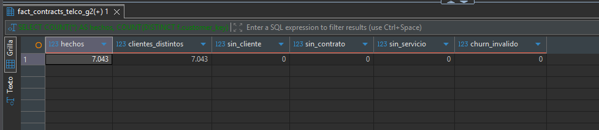
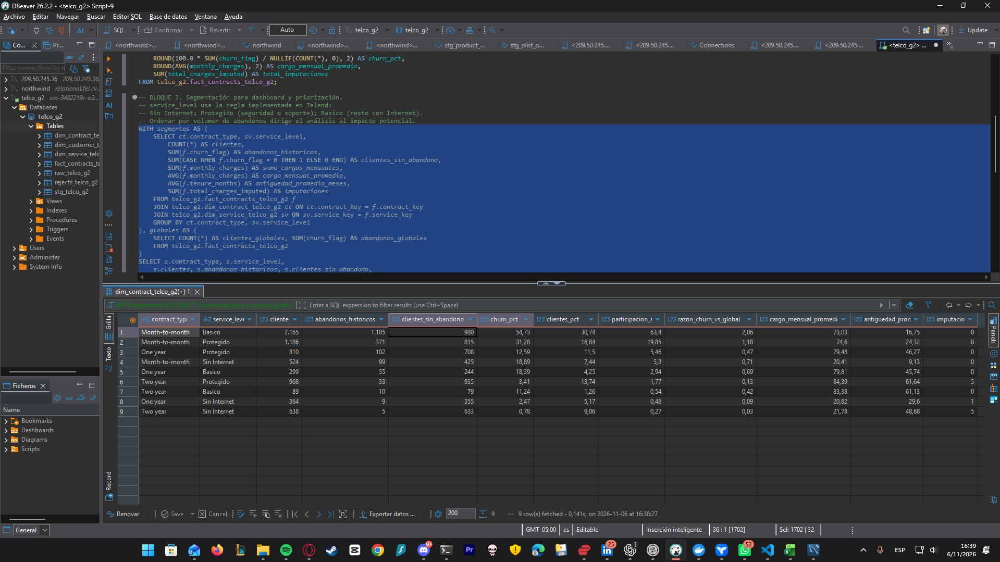
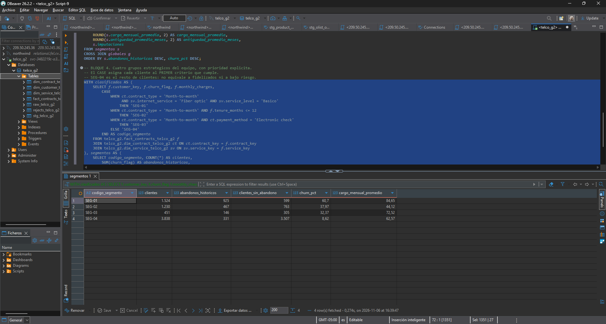
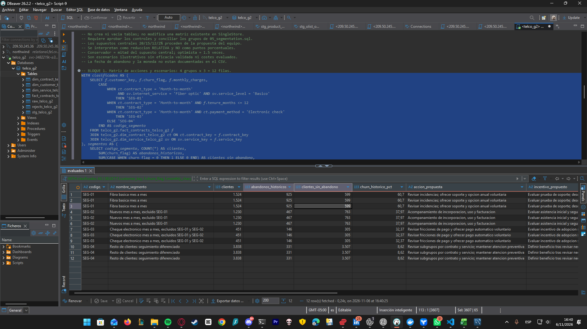
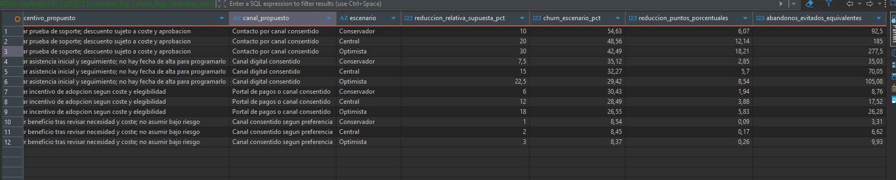
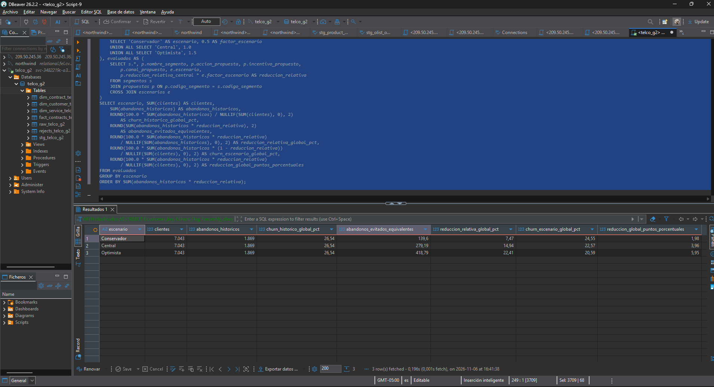

# Segmentación y recomendador de retención — resultados Cloud

Fecha de evidencia: 6 de noviembre de 2026. Entorno: SingleStore Cloud, base `telco_g2`. Fuente: IBM Telco Customer Churn. Ejecución realizada por el equipo en DBeaver; este reporte transcribe los resultados de sus capturas.

## Alcance y controles

Se integró la propuesta de cuatro grupos y acciones publicada por el equipo en el commit 275995f con el análisis de nueve cruces contrato × nivel de servicio y los controles del modelo. Las tasas históricas se calculan sobre los datos; los efectos de las acciones son supuestos explícitos.

Los controles de [05_segmentation.sql](../../sql/05_segmentation.sql), bloque 1, mostraron:

| Control | Resultado |
|---|---:|
| Hechos | 7.043 |
| Clientes distintos | 7.043 |
| Sin dimensión de cliente | 0 |
| Sin dimensión de contrato | 0 |
| Sin dimensión de servicio | 0 |
| Churn inválido | 0 |

Los resultados de segmentación suman 7.043 clientes y 1.869 abandonos históricos: tasa global 26,54%. El modelo representa una instantánea de clientes; no es una serie mensual ni un historial de contratos. El análisis original de raw se conserva en [el reporte del 5 de noviembre](../data_quality/2026-11-05_perfilado_y_exploracion_raw.md).

## Nueve segmentos por contrato y nivel de servicio

El bloque 3 produjo los siguientes grupos. Basico, Protegido y Sin Internet son las categorías derivadas por el job Talend del modelo, según la [guía de reglas](../catalogo/segmentacion_y_recomendador.md).

| Contrato | Nivel de servicio | Clientes | Abandonos históricos | Churn |
|---|---|---:|---:|---:|
| Month-to-month | Basico | 2.165 | 1.185 | 54,73% |
| Month-to-month | Protegido | 1.186 | 371 | 31,28% |
| One year | Protegido | 810 | 102 | 12,59% |
| Month-to-month | Sin Internet | 524 | 99 | 18,89% |
| One year | Basico | 299 | 55 | 18,39% |
| Two year | Protegido | 968 | 33 | 3,41% |
| Two year | Basico | 89 | 10 | 11,24% |
| One year | Sin Internet | 364 | 9 | 2,47% |
| Two year | Sin Internet | 638 | 5 | 0,78% |
| **Total** | | **7.043** | **1.869** | **26,54%** |

**Hallazgo principal:** mes a mes + Basico contiene el 30,74% de los clientes y concentra el 63,40% de los abandonos. Su churn es 54,73%, aproximadamente 2,06 veces la tasa global. Es un grupo prioritario para investigar causas y probar acciones. La asociación observada no demuestra que cambiar de contrato o añadir soporte reduzca por sí mismo el abandono.

No confundir este grupo con mes a mes + fibra básica: el primero incluye varias tecnologías de Internet. Tampoco comparar grupos pequeños solo por su tasa: Two year + Basico tiene 89 clientes y 10 abandonos.

Las imputaciones visibles en esta salida suman 11: cinco en Two year + Protegido, una en One year + Sin Internet y cinco en Two year + Sin Internet. El tratamiento sigue documentado en [el reporte DQ de staging](../data_quality/2026-11-06_reporte_dq_staging_cloud.md).

## Cuatro grupos estratégicos para organizar acciones

El bloque 4 utiliza un CASE ordenado: cada cliente entra en el primer criterio que cumple. Los cuatro grupos son excluyentes y cubren toda la instantánea; son una segunda clasificación, no cuatro grupos que deban sumarse a los nueve anteriores.

| Grupo | Regla efectiva | Clientes | Abandonos históricos | Churn | Cargo mensual medio |
|---|---|---:|---:|---:|---:|
| SEG-01 | Mes a mes + fibra + Basico | 1.524 | 925 | 60,70% | 84,65 |
| SEG-02 | Mes a mes + antigüedad ≤12 meses, excluido SEG-01 | 1.230 | 467 | 37,97% | 44,12 |
| SEG-03 | Mes a mes + Electronic check, excluidos SEG-01/02 | 451 | 146 | 32,37% | 72,52 |
| SEG-04 | Todos los clientes restantes | 3.838 | 331 | 8,62% | 62,57 |
| **Total** | | **7.043** | **1.869** | **26,54%** | |

El grupo SEG-04 no se considera automáticamente fidelizado ni de bajo riesgo. Los cargos se expresan en las unidades de la fuente: el CSV no documenta moneda. No equivalen a margen ni a ingresos recuperados.

## Recomendador: matriz de acciones propuestas

El bloque 1 de [06_recomendador_retencion.sql](../../sql/06_recomendador_retencion.sql) produjo 12 filas: cuatro grupos × tres escenarios. La salida es una tabla de resultados de consulta; no crea una tabla física ni una vista y no reemplaza objetos que pudiera haber creado la versión anterior del script.

| Grupo | Acción propuesta | Reducción relativa central supuesta |
|---|---|---:|
| SEG-01 | Revisar incidencias; ofrecer soporte y opción anual voluntaria | 20% |
| SEG-02 | Acompañar incorporación, uso y facturación | 15% |
| SEG-03 | Revisar fricciones de pago y ofrecer pago automático voluntario | 12% |
| SEG-04 | Revisar subgrupos y mantener atención preventiva | 2% |

Los incentivos requieren revisar costes, elegibilidad y aceptación. Los porcentajes centrales conservan la propuesta del equipo como hipótesis; no son eficacias estimadas con este dataset. Conservador usa la mitad de cada supuesto y optimista 1,5 veces. No representan intervalos de confianza.

La captura de SEG-01 ilustra la diferencia entre porcentaje y puntos: churn histórico 60,70%, reducción relativa central supuesta 20%, churn del escenario 48,56% y reducción de 12,14 puntos porcentuales. Los abandonos evitados equivalentes serían 185 sobre una población comparable; no son clientes efectivamente retenidos.

## KPI global: tres escenarios hipotéticos

El bloque 2 agrega cada escenario por separado, ponderando los abandonos de cada grupo. Los tres mantienen la misma base de 7.043 clientes y 1.869 abandonos históricos.

| Escenario | Churn histórico | Abandonos evitados equivalentes | Reducción relativa global | Churn del escenario | Reducción en puntos porcentuales |
|---|---:|---:|---:|---:|---:|
| Conservador | 26,54% | 139,60 | 7,47% | 24,55% | 1,98 |
| Central | 26,54% | 279,19 | 14,94% | 22,57% | 3,96 |
| Optimista | 26,54% | 418,79 | 22,41% | 20,59% | 5,95 |

Las fórmulas usan las tasas y cantidades sin redondear; el resultado se redondea al final. Por eso restar visualmente 26,54 − 22,57 no reproduce exactamente la reducción central de 3,96 puntos. No sumar clientes ni proyecciones entre escenarios alternativos.

**Mensaje para la demo:** bajo los supuestos del escenario central, la tasa pasaría de 26,54% a 22,57%, una reducción relativa de 14,94% o 3,96 puntos porcentuales, equivalente a unos 279 abandonos menos en una población comparable. Es una simulación; para medir impacto real haría falta probar las acciones y comparar resultados con un grupo adecuado.

## Estado de entrega y pasos siguientes

- Segmentación y consultas del recomendador ejecutadas en Cloud, con las capturas del equipo guardadas sin alteraciones.
- Matriz de acciones disponible como resultado SQL reproducible. No se declara un recomendador predictivo ni una campaña ejecutada.
- Dashboard pendiente: filtrar por escenario para evitar duplicar clientes; mostrar por separado tasas históricas y supuestos.
- Calendario y auditoría: el script 13 se corrigió en el repositorio y el SQL 14 está preparado. Estas capturas no acreditan su ejecución o cobertura completa en la base.
- Snowflake, orquestación TMC y la demo completa siguen sus tareas independientes; estos resultados no acreditan que esos tramos estén terminados.
