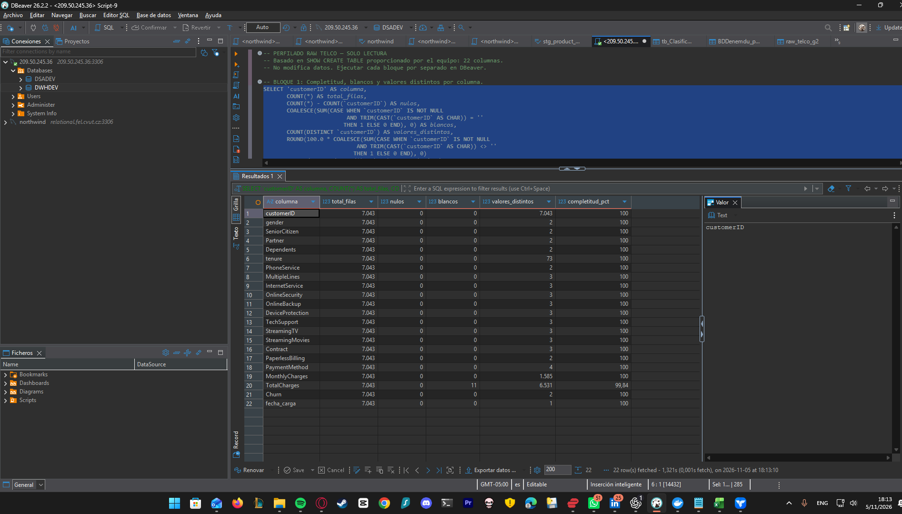
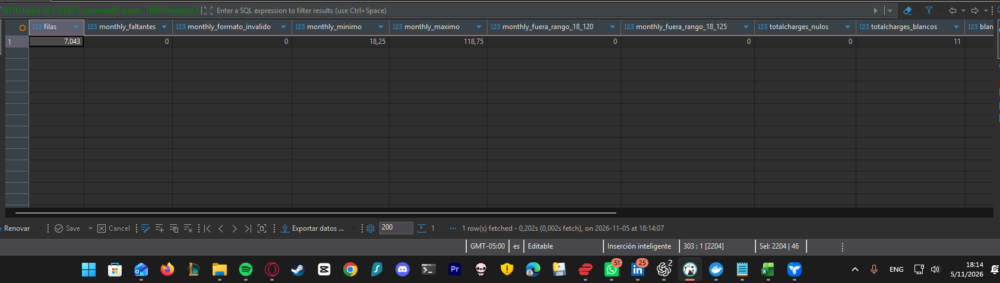
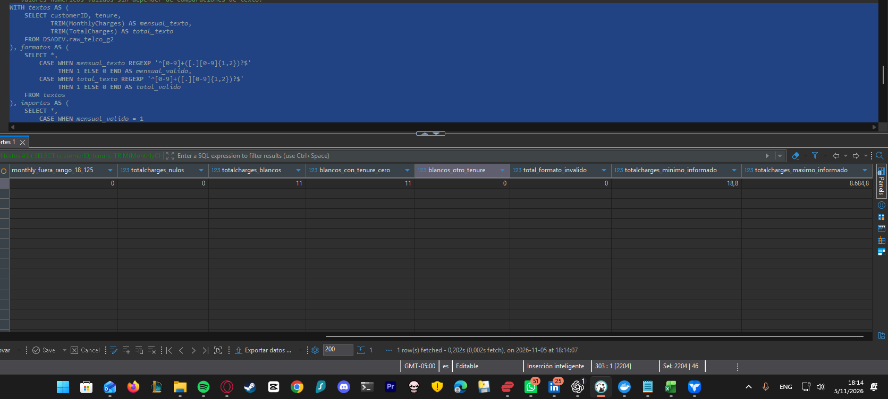
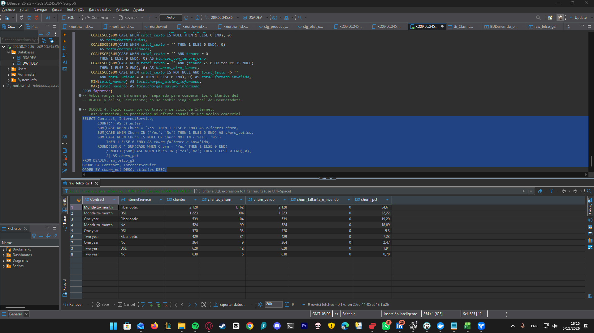
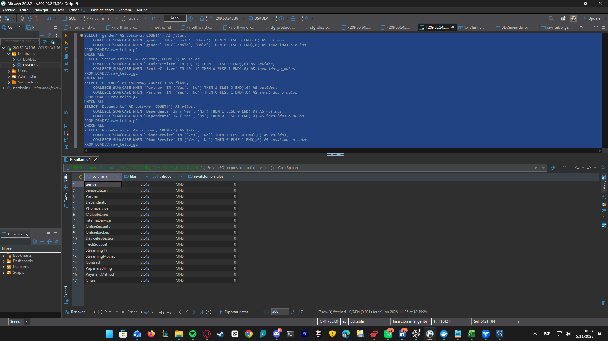
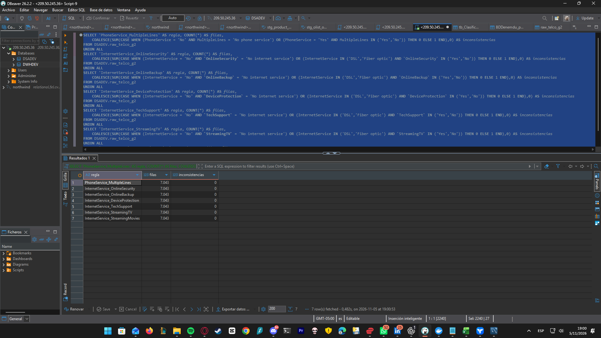

# Perfilado SQL y exploración inicial — Telco raw

Fecha: 5 de noviembre de 2026. Tabla: `DSADEV.raw_telco_g2`.
Resultados observados en las capturas SQL compartidas por el equipo. Las consultas son de solo lectura; no se imputaron datos ni se cambió la tabla.

## Perfil de las 22 columnas

| Control | Resultado |
|---|---:|
| Filas | 7.043 |
| Columnas | 22: 21 originales y fecha_carga |
| NULL | 0 en todas las columnas |
| customerID distintos | 7.043 |
| customerID duplicados | 0 |
| Columnas completas respecto a nulos y blancos | 21 de 22 |
| TotalCharges en blanco | 11 |
| Completitud TotalCharges | 99,84% |

Los valores distintos incluyen respuestas válidas como No phone service y No internet service. Además del perfilado, se ejecutaron los controles de dominios y consistencia de `sql/08_validacion_categorias_y_servicios.sql`; los resultados se documentan a continuación.

## Importes: validación numérica del texto

| Control | MonthlyCharges | TotalCharges |
|---|---:|---:|
| NULL | 0 | 0 |
| Blancos | 0 | 11 |
| Valores informados con formato inválido | 0 | 0 |
| Mínimo informado | 18,25 | 18,80 |
| Máximo informado | 118,75 | 8.684,80 |

MonthlyCharges no presenta valores fuera de 18–120 ni de 18–125. Ambos criterios pasan sobre este archivo; el equipo debe usar un mismo límite en README, SQL y catálogo. La consulta valida el formato y convierte explícitamente los importes antes de comparar rangos; no utiliza el orden de cadenas.

Los 11 blancos de TotalCharges tienen tenure = 0; no se observaron blancos con otra antigüedad. Raw los conserva y el tratamiento corresponde a la capa posterior. Esta revisión no certifica que el modelo dimensional esté cargado.

## Exploración: contrato y tipo de Internet

| Contrato | Internet | Clientes | Churn Yes | Churn histórico |
|---|---|---:|---:|---:|
| Month-to-month | Fiber optic | 2.128 | 1.162 | 54,61% |
| Month-to-month | DSL | 1.223 | 394 | 32,22% |
| One year | Fiber optic | 539 | 104 | 19,29% |
| Month-to-month | No | 524 | 99 | 18,89% |
| One year | DSL | 570 | 53 | 9,30% |
| Two year | Fiber optic | 429 | 31 | 7,23% |
| One year | No | 364 | 9 | 2,47% |
| Two year | DSL | 628 | 12 | 1,91% |
| Two year | No | 638 | 5 | 0,78% |

Reconciliación: los nueve segmentos suman 7.043 clientes y 1.869 abandonos, tasa global 26,54%. Todos muestran cero valores faltantes o inválidos en Churn.

El segmento mes a mes con fibra concentra 1.162 de los 1.869 abandonos (62,17%). Es una prioridad para investigar antigüedad, soporte y condiciones del servicio. Es una asociación histórica; no prueba causalidad ni permite prometer una reducción de churn. Las acciones comerciales son hipótesis para validar con una intervención y seguimiento.

## Validación de categorías y coherencia de servicios

### Dominios permitidos

La ejecución SQL del 5 de noviembre de 2026 a las 18:59 (UTC-05:00) muestra **7.043 valores válidos y 0 inválidos o nulos en cada una de las 17 columnas evaluadas**:

gender, SeniorCitizen, Partner, Dependents, PhoneService, MultipleLines, InternetService, OnlineSecurity, OnlineBackup, DeviceProtection, TechSupport, StreamingTV, StreamingMovies, Contract, PaperlessBilling, PaymentMethod y Churn.

El cumplimiento observado es 100% para cada uno de estos controles de dominio. Se respetan las categorías No phone service y No internet service; no se consideran datos faltantes ni se reemplazan por No.

### Coherencia entre servicios

La ejecución SQL del 5 de noviembre de 2026 a las 19:00 (UTC-05:00) evalúa 7.043 registros por regla y muestra:

| Regla | Inconsistencias |
|---|---:|
| PhoneService / MultipleLines | 0 |
| InternetService / OnlineSecurity | 0 |
| InternetService / OnlineBackup | 0 |
| InternetService / DeviceProtection | 0 |
| InternetService / TechSupport | 0 |
| InternetService / StreamingTV | 0 |
| InternetService / StreamingMovies | 0 |

Se verifica que, sin teléfono, MultipleLines indique No phone service; con teléfono, Yes o No. Sin Internet, los seis servicios asociados deben indicar No internet service; con DSL o fibra, Yes o No.

Estos resultados corresponden a controles SQL ejecutados en DBeaver, no a nuevos casos creados en OpenMetadata. No eliminan el hallazgo de los 11 blancos de TotalCharges ni implican certificación de calidad global.

## Evidencias

### Completitud por columna

### Importes: primera parte

### Importes: segunda parte

### Segmentación exploratoria

### Categorías permitidas

### Coherencia entre servicios

## Reproducción

Ejecutar los bloques 1, 3 y 4 de `sql/07_perfilado_completo_raw_telco.sql`. El bloque 2 permite conservar una evidencia específica de duplicados. Los bloques 1 y 2 de `sql/08_validacion_categorias_y_servicios.sql` reproducen las validaciones de dominios y coherencia documentadas. Su bloque 3 ofrece una distribución adicional de respuestas; no se incluye como resultado ejecutado en este reporte.
