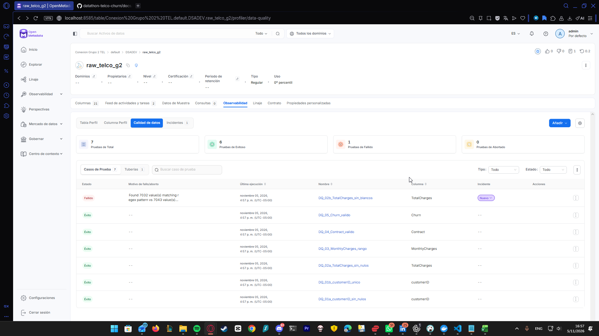
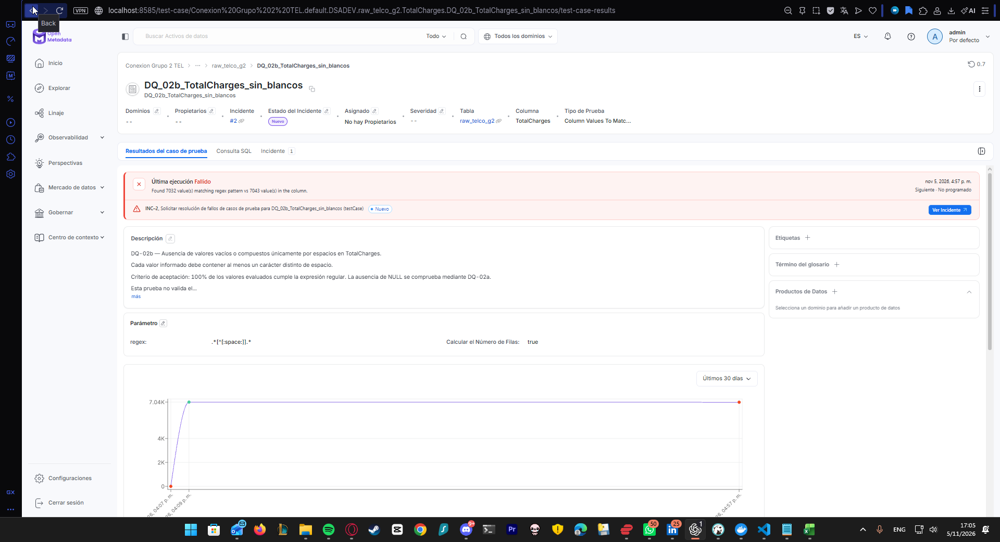
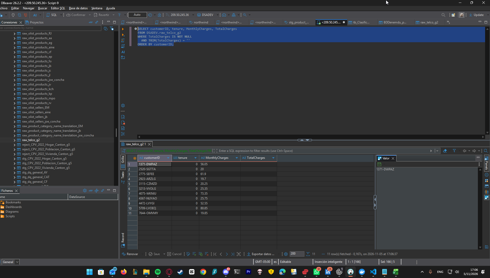

# Reporte inicial de calidad de datos — Capa raw Telco Churn

## 1. Alcance

- Fecha: 5 de noviembre de 2026.
- Proyecto: Genius Lab — Telco, segmentación y retención.
- Fuente: IBM Telco Customer Churn, archivo Telco-Customer-Churn.csv.
- Destino de ingesta: DSADEV.raw_telco_g2 en SingleStore.
- Catálogo: OpenMetadata 2.0.7, servicio Conexion Grupo 2 TEL.

El objetivo de la capa raw es conservar los valores recibidos del CSV, incluidos sus blancos y espacios, sin imputar, depurar ni corregir el contenido. El equipo informa que MonthlyCharges y TotalCharges se cargaron como String para preservar su representación original. Los datos originales se mantienen como referencia para medir la calidad y reproducir las transformaciones posteriores.

## 2. Perfil inicial de la fuente

Los siguientes resultados se obtuvieron mediante análisis del CSV original:

| Indicador | Resultado observado en el CSV |
|---|---:|
| Registros | 7.043 |
| Columnas | 21 |
| customerID distintos | 7.043 |
| customerID vacíos o compuestos solo por espacios | 0 |
| TotalCharges en blanco o compuesto solo por espacios | 11 |
| Clientes con TotalCharges en blanco y tenure = 0 | 11 |
| MonthlyCharges mínimo, interpretado como número | 18,25 |
| MonthlyCharges máximo, interpretado como número | 118,75 |
| Contract fuera del dominio permitido | 0 |
| Churn fuera de Yes / No | 0 |
| Clientes con Churn = Yes | 1.869 (26,54%) |

## 3. Hallazgo de calidad: TotalCharges

La fuente contiene **11 valores en blanco en TotalCharges**, todos correspondientes a clientes con tenure = 0. La capa raw debe conservar estos valores tal como llegan. No deben sustituirse por cero ni por otro valor durante esta ingesta.

La completitud de TotalCharges respecto a blancos en el CSV es:

**(7.043 − 11) / 7.043 × 100 = 99,84%.**

Un valor en blanco o compuesto por espacios no equivale a un NULL. La comprobación de nulos y la comprobación de blancos se reportan por separado. En una carga fiel de este archivo, los 11 casos deben mantenerse como blancos; convertirlos a NULL sería una normalización que debe documentarse.

La presencia de estos 11 blancos constituye un hallazgo conocido de la fuente. Su conservación no significa que la ingesta haya fallado: la fidelidad de la carga y la completitud del dato son controles distintos.

## 4. Reglas iniciales y criterios de evaluación

| Regla | Comprobación | Criterio de calidad | Referencia para la raw fiel a esta fuente |
|---|---|---|---|
| DQ-01a | customerID sin NULL | 0 NULL | No se esperan faltantes |
| DQ-01b | customerID único | 0 duplicados | 7.043 identificadores distintos |
| DQ-02a | TotalCharges sin NULL | 0 NULL | Comprobar por separado; los blancos no son NULL |
| DQ-02b | TotalCharges sin blancos | 0 blancos | Se esperan 11 incumplimientos conocidos; completitud 99,84% |
| DQ-03 | MonthlyCharges numérico y dentro de rango | Valores interpretables como número y entre 18 y 120 | 0 incumplimientos en el CSV; adaptar la prueba al tipo String |
| DQ-04 | Contract en dominio válido | Month-to-month, One year o Two year | 0 categorías inesperadas en el CSV |
| DQ-05 | Churn en dominio válido | Yes o No | 0 categorías inesperadas en el CSV |

La meta del proyecto es al menos 99% de conformidad global, con fórmula de agregación por acordar. La completitud de TotalCharges en la fuente supera 99%, pero la prueba estricta de ausencia de blancos debe detectar los 11 casos. No debe modificarse el dato para que la raw pase una prueba cuyo propósito es revelar ese hallazgo.

### Resultados confirmados en OpenMetadata

Las capturas de la ejecución del **5 de noviembre de 2026 a las 16:57 (UTC-05:00, Ecuador)** muestran **7 pruebas ejecutadas: 6 exitosas, 1 fallida y 0 abortadas**.

| Caso de prueba | Estado observado |
|---|---|
| DQ_01a_customerID_sin_nulos | Éxito |
| DQ_01b_customerID_unico | Éxito |
| DQ_02a_TotalCharges_sin_nulos | Éxito |
| DQ_02b_TotalCharges_sin_blancos | Fallido: 7.032 valores cumplen de 7.043; diferencia de 11 valores |
| DQ_03_MonthlyCharges_rango | Éxito |
| DQ_04_Contract_valido | Éxito |
| DQ_05_Churn_valido | Éxito |

En DQ-02b se observa el patrón `.*[^[:space:]].*` y el cálculo de filas activado. El resultado de **7.032 / 7.043 = 99,84%** es consistente con los 11 blancos encontrados en la fuente y esperados en la capa raw. DQ-02a pasa porque los blancos no son NULL.

El fallo de DQ-02b registra una carencia conocida de completitud del dato original; no implica por sí solo un error de ingesta. La ausencia de blancos se exigirá en la capa depurada después del tratamiento. El incidente asociado aparece con estado Nuevo en la captura y debe documentarse con este contexto, sin declarar que el problema de la fuente fue corregido.

La proporción de pruebas aprobadas es **6 / 7 = 85,71%**. Es una métrica distinta de la completitud de TotalCharges, **99,84%**; ninguna equivale automáticamente a la calidad global del dataset.

Aunque DQ-03 aparece exitosa, falta revisar la consulta y el criterio numérico tras el cambio de MonthlyCharges a texto para descartar comparaciones lexicográficas o conversiones implícitas inadecuadas. Las capturas no muestran los tipos actualizados ni los conteos individuales de las otras seis pruebas.

## 5. Verificación de fidelidad de la carga

Ejecutar sobre SingleStore y guardar los resultados:

```sql
SELECT
    COUNT(*) AS total_registros,
    COUNT(DISTINCT customerID) AS customerid_distintos,
    SUM(CASE
        WHEN TotalCharges IS NOT NULL
         AND TRIM(TotalCharges) = '' THEN 1 ELSE 0
    END) AS totalcharges_blancos,
    SUM(CASE WHEN TotalCharges IS NULL THEN 1 ELSE 0 END)
        AS totalcharges_nulos
FROM DSADEV.raw_telco_g2;
```

Resultado de referencia para una carga fiel: **7.043 registros, 7.043 identificadores distintos, 11 blancos y 0 NULL en TotalCharges**. Estos controles son necesarios, pero por sí solos no prueban igualdad completa de todos los valores con el CSV.

```sql
SELECT customerID, tenure, MonthlyCharges, TotalCharges
FROM DSADEV.raw_telco_g2
WHERE TotalCharges IS NOT NULL
  AND TRIM(TotalCharges) = ''
ORDER BY customerID;
```

Esta consulta debe mostrar los 11 clientes con TotalCharges en blanco y tenure = 0. El valor almacenado puede contener espacios aunque la herramienta lo muestre visualmente vacío.

## 6. Tratamiento previsto en staging

El tratamiento se aplica después de raw, en una capa staging o depurada:

- Validar los formatos antes de convertir MonthlyCharges y TotalCharges a DECIMAL.
- Aplicar la regla acordada para los blancos de TotalCharges con tenure = 0: imputación a 0,00.
- Conservar una marca de imputación y el vínculo con el registro original.
- Separar y revisar valores no convertibles; no sustituirlos silenciosamente por cero.
- Ejecutar las reglas de calidad nuevamente y medir los resultados después del tratamiento.

Estas acciones son previstas; este reporte no declara que staging esté implementada o validada.

## 7. Evidencias

### 7.1 Resumen de la ejecución sobre raw

La vista general muestra siete casos de prueba, seis exitosos y uno fallido, con última ejecución a las 16:57 del 5 de noviembre de 2026.



### 7.2 Detalle del hallazgo de TotalCharges

La vista de DQ-02b muestra el patrón configurado, el conteo activado y 7.032 coincidencias entre 7.043 valores. Los 11 restantes no cumplen la condición de tener al menos un carácter distinto de espacio.



### 7.3 Evidencia SQL complementaria

La consulta sobre DSADEV.raw_telco_g2 identifica 11 registros cuyo TotalCharges está vacío o contiene únicamente espacios. Los registros presentan tenure = 0, consistente con el hallazgo del CSV original.

La capa raw conserva estos valores sin imputarlos. El tratamiento se realizará en staging. 

## 8. Pendientes de cierre

- Adjuntar el resultado SQL de los 11 blancos en raw.
- Confirmar que los tipos actualizados constan en el catálogo.
- Revisar la consulta de rango de MonthlyCharges, ahora que la columna es texto.
- Registrar en el incidente de DQ-02b el hallazgo conocido y su tratamiento previsto en staging.
- Unificar el intervalo de MonthlyCharges: README y prueba usan 18–120; el SQL revisado usa 18–125.
- Completar el diccionario de columnas y el linaje real conforme se implementen las etapas.

Referencia del proyecto: https://github.com/jennifferB/datathon-telco-churn
