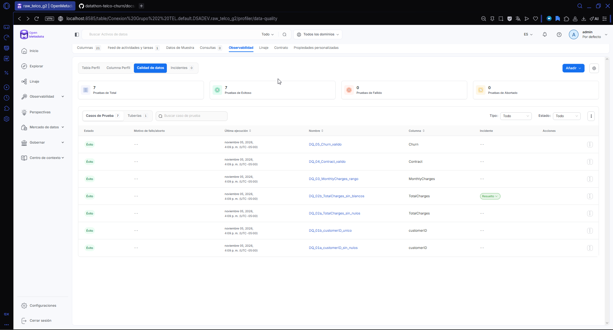

# Reporte inicial de calidad de datos — Telco Churn

## Alcance y evidencia

- Fecha de evaluación: 5 de noviembre de 2026.
- Última ejecución mostrada: 16:09, UTC-05:00 (hora de Ecuador).
- Plataforma de validación: OpenMetadata 2.0.7.
- Servicio del catálogo: Conexion Grupo 2 TEL.
- Tabla evaluada: DSADEV.raw_telco_g2 en SingleStore, mediante el conector MySQL.
- Dataset fuente: IBM Telco Customer Churn.
- Perfil del CSV analizado: 7.043 registros y 21 columnas.
- Evidencia de los estados de ejecución: captura incluida al final de este reporte.

Este reporte distingue el perfil del CSV original de las pruebas ejecutadas sobre la tabla destino. La captura de estados no muestra conteos de filas evaluadas o fallidas por cada prueba; esos detalles deben consultarse en cada caso antes de informar porcentajes de conformidad por fila.

## Reglas y resultados de OpenMetadata

| Regla del proyecto | Caso de prueba | Validación | Criterio configurado/documentado | Último estado |
|---|---|---|---|---|
| DQ-01a | DQ_01a_customerID_sin_nulos | Identificador sin NULL | 0 valores NULL | Éxito |
| DQ-01b | DQ_01b_customerID_unico | Identificador único | 0 identificadores duplicados | Éxito |
| DQ-02a | DQ_02a_TotalCharges_sin_nulos | TotalCharges sin NULL | 0 valores NULL | Éxito |
| DQ-02b | DQ_02b_TotalCharges_sin_blancos | Valor con al menos un carácter distinto de espacio | Patrón `.*[^[:space:]].*` | Éxito |
| DQ-03 | DQ_03_MonthlyCharges_rango | Cargos mensuales en el intervalo acordado | Entre 18 y 120, según el README | Éxito |
| DQ-04 | DQ_04_Contract_valido | Categorías de contrato válidas | Month-to-month, One year, Two year | Éxito |
| DQ-05 | DQ_05_Churn_valido | Categorías válidas de abandono | Yes, No | Éxito |

Resultado de la última ejecución: **7 pruebas ejecutadas, 7 exitosas, 0 fallidas y 0 abortadas**. Las siete comprobaciones cubren las cinco reglas del proyecto, con DQ-01 y DQ-02 desglosadas.

La tasa de pruebas aprobadas es 7/7 = **100%**. Este indicador no equivale a verificar todas las dimensiones de calidad ni sustituye la medición de conformidad por fila. El proyecto documenta una meta global de al menos 99%; queda pendiente especificar su fórmula de agregación y relacionarla con los resultados detallados de cada prueba.

## Tratamiento de TotalCharges: antes y después

El análisis del CSV original encontró 11 valores en blanco en TotalCharges, todos con tenure = 0. La completitud respecto a blancos en esa fuente fue (7.043 - 11) / 7.043 = **99,84%**.

Las consultas SQL revisadas sobre la tabla destino mostraron:

- 0 valores NULL o vacíos después de aplicar TRIM a TotalCharges.
- 11 clientes con tenure = 0 y TotalCharges = 0.00.

Estos resultados son consistentes con la imputación a cero declarada por el equipo. La completitud respecto a nulos y blancos en la tabla destino es **100%**. Las capturas SQL de estas comprobaciones deben añadirse como evidencia complementaria.

Aunque se llama raw_telco_g2, la tabla actual contiene datos tratados. El equipo debe acordar si conserva una capa raw fiel al CSV y una capa depurada separada. No se modificaron los datos para elaborar este reporte.

## Incidencia de configuración DQ-02b

La ejecución inicial de DQ-02b devolvió 0 coincidencias de 7.043 valores con el patrón anterior `.*\S.*`. Se cambió por `.*[^[:space:]].*`, que evita la barra invertida. En la nueva ejecución, la prueba pasó sin cambiar los datos.

La diferencia apunta a la interpretación o transmisión de la expresión regular; no se inspeccionó la consulta generada para determinar la causa exacta. En la última captura aún figura un incidente con estado Nuevo: queda pendiente revisarlo y cerrarlo con esta explicación.

## Pendientes

- Unificar el rango de MonthlyCharges: README y prueba usan 18–120; el SQL revisado usa 18–125.
- Verificar y conservar parámetros y conteos detallados de cada caso de prueba.
- Completar el diccionario de las 21 columnas y asignar responsables reales.
- Incorporar comprobaciones de customerID vacío o compuesto únicamente por espacios.
- Evaluar completitud de MonthlyCharges, Contract y Churn por separado; las reglas de rango/dominio no certifican por sí solas ausencia de NULL.
- Documentar el linaje real entre CSV, SingleStore y Snowflake cuando estén implementadas las etapas.
- Este reporte no certifica todavía la calidad global ni el pipeline end-to-end.

## Evidencia

Referencia del proyecto: https://github.com/jennifferB/datathon-telco-churn
