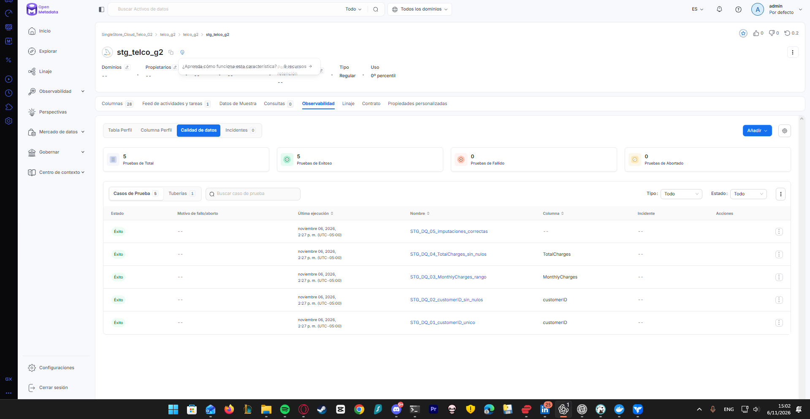
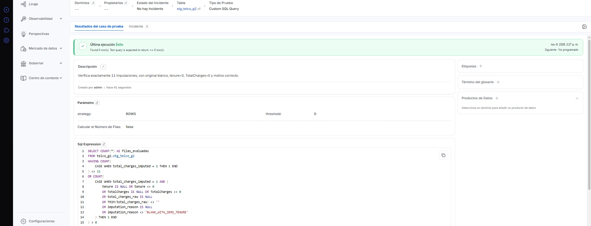
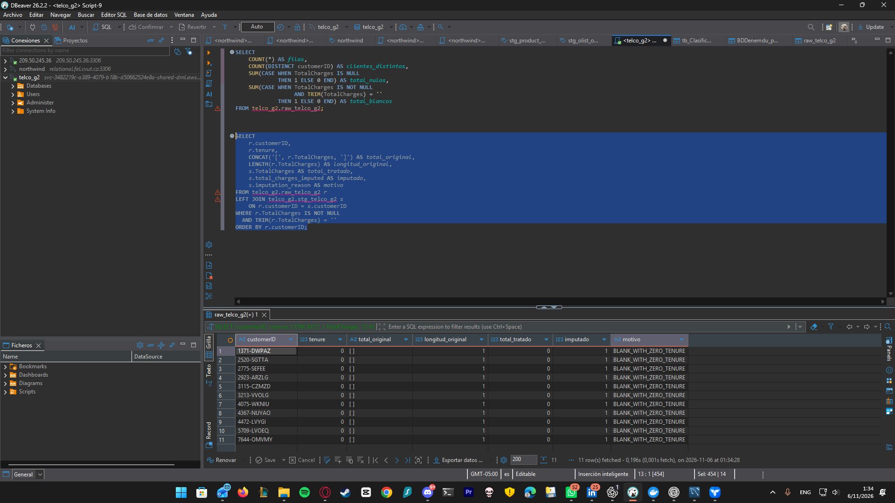

# Calidad de staging en SingleStore Cloud — 6 de noviembre de 2026

## Alcance

Servicio OpenMetadata: `SingleStore_Cloud_Telco_G2`. Base y esquema catalogados: `telco_g2.telco_g2`. Tabla evaluada: `telco_g2.stg_telco_g2`, con 28 columnas. Este reporte documenta el tratamiento posterior a raw y sus cinco casos de prueba; conserva el diagnóstico original de la fuente.

La captura del catálogo muestra siete tablas y la ejecución DQ del 6 de noviembre a las 14:27 (UTC-05:00) muestra cinco éxitos, cero fallos y cero abortos. No se modificaron datos desde OpenMetadata: las transformaciones corresponden a los jobs de Talend.

## Resultados de OpenMetadata

| Caso | Alcance | Criterio de aceptación | Resultado |
|---|---|---|---|
| STG_DQ_01_customerID_unico | customerID | Sin valores duplicados | Éxito |
| STG_DQ_02_customerID_sin_nulos | customerID | Cero NULL | Éxito |
| STG_DQ_03_MonthlyCharges_rango | MonthlyCharges | Valores entre 18 y 120, inclusive | Éxito |
| STG_DQ_04_TotalCharges_sin_nulos | TotalCharges | Cero NULL después del tratamiento | Éxito |
| STG_DQ_05_imputaciones_correctas | Tabla | Exactamente 11 marcas de imputación; todas cumplen las condiciones definidas | Éxito |

El quinto caso usa Custom SQL Query, estrategia `ROWS`, umbral `0`. La consulta devuelve cero filas cuando los controles se cumplen. Revisa que cada registro marcado como imputado tenga tenure=0, TotalCharges=0, total_charges_raw informado pero compuesto solo por blancos y motivo `BLANK_WITH_ZERO_TENURE`.

```sql
SELECT COUNT(*) AS filas_evaluadas
FROM telco_g2.stg_telco_g2
HAVING COUNT(
    CASE WHEN total_charges_imputed = 1 THEN 1 END
) <> 11
OR COUNT(
    CASE WHEN total_charges_imputed = 1 AND (
        tenure IS NULL OR tenure <> 0
        OR TotalCharges IS NULL OR TotalCharges <> 0
        OR total_charges_raw IS NULL
        OR TRIM(total_charges_raw) <> ''
        OR imputation_reason IS NULL
        OR imputation_reason <> 'BLANK_WITH_ZERO_TENURE'
    ) THEN 1 END
) > 0
```

El número 11 corresponde a esta versión del CSV; para una fuente diferente hay que revisar esa expectativa, no forzar los datos para satisfacerla. Este control no sustituye la comparación de todos los atributos ni comprueba por sí mismo las relaciones de hechos.

## Comparación raw → staging

La consulta DBeaver, unida por customerID, muestra 11 clientes con tenure=0:

- Raw conserva un espacio en TotalCharges: longitud_original=1.
- Staging muestra el importe tratado en cero, marca total_charges_imputed=1 y el motivo acordado.
- Se conserva la representación original en total_charges_raw.

La evidencia permite verificar estos 11 casos concretos. Los conteos generales y la conciliación del modelo se verifican con los jobs y `sql/12_validacion_modelo_cloud.sql`; esta captura no prueba por sí sola igualdad de todas las columnas entre entornos.

## Medición y límites

- Aprobación de controles de staging: **5/5 = 100% de los casos definidos**.
- Completitud inicial de TotalCharges en raw: **7032/7043 = 99,8438%**, redondeada a 99,84%. El cambio de servidor no elimina los blancos originales.
- No se calcula una calidad global de todas las columnas a partir de cinco casos. La meta global ≥99% sigue requiriendo una definición explícita de cobertura y agregación.
- La prueba de ausencia de NULL no detecta cadenas vacías; la de unicidad no reemplaza un control de formato del identificador.
- El historial MySQL no es accesible en esta conexión. El linaje fue registrado manualmente conforme al código de los jobs; no se presenta como extracción automática de consultas.

## Evidencias







- [Catálogo Cloud con siete tablas](../catalogo/2026-11-06_catalogo_cloud_7_tablas.png).
- [Linaje Cloud: siete activos y nueve relaciones](../lineage/2026-11-06_linaje_singlestore_cloud.md).
- [Diagnóstico raw original, 5 de noviembre](2026-11-05_reporte_dq_inicial.md).
- [Perfilado y exploración raw original](2026-11-05_perfilado_y_exploracion_raw.md).

## Cómo repetir la comprobación

1. En el servicio Cloud de OpenMetadata, abrir stg_telco_g2 → Observabilidad → Calidad de datos.
2. Ejecutar su tubería DQ bajo demanda; no volver a ejecutar la ingesta o las cargas de Talend.
3. Comprobar las cinco pruebas y guardar evidencia de la nueva ejecución con su fecha.
4. Para repetir el diagnóstico raw en Cloud usar las consultas de `sql/cloud/`, por sentencias. Las consultas originales que apuntan a DSADEV se conservan como referencia histórica.
