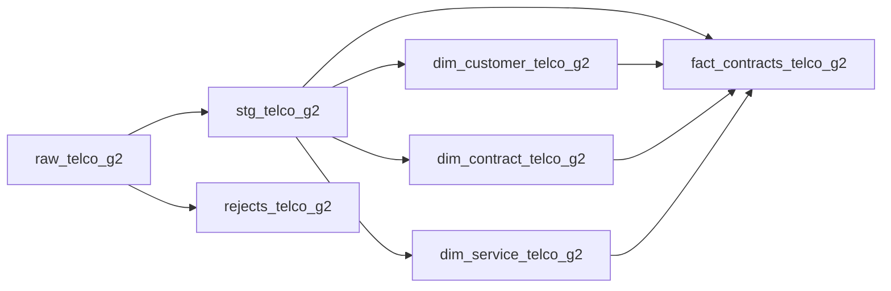
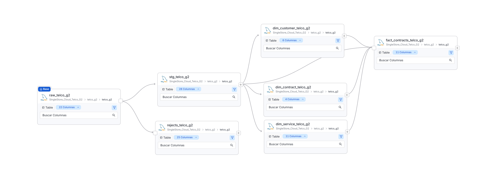

# Linaje en SingleStore Cloud — 6 de noviembre de 2026

Servicio OpenMetadata: `SingleStore_Cloud_Telco_G2`. Base física: `telco_g2`. El grafo exportado documenta siete tablas y nueve relaciones a nivel de tabla, registradas manualmente de acuerdo con la lectura y escritura de los jobs Talend.

| Tabla | Columnas catalogadas | Función |
|---|---:|---|
| raw_telco_g2 | 22 | Valores originales y fecha_carga |
| stg_telco_g2 | 28 | Validación, importes tipados, originales y trazabilidad de imputación |
| rejects_telco_g2 | 25 | Datos rechazados y motivos; puede tener cero filas y conservar su linaje |
| dim_customer_telco_g2 | 6 | Atributos del cliente y clave sustituta |
| dim_contract_telco_g2 | 4 | Combinaciones de contrato, facturación y pago |
| dim_service_telco_g2 | 11 | Combinaciones de servicios y nivel derivado |
| fact_contracts_telco_g2 | 11 | Una fila por cliente en la fotografía del dataset; claves, medidas y trazabilidad |

## Transformaciones de los enlaces

- **Raw → staging:** job_telco_staging valida dominios, coherencia de servicios e importes. Convierte los importes a DECIMAL y asigna 0.00 solo a TotalCharges en blanco con tenure=0, conservando original, marca y motivo.
- **Raw → rechazos:** el mismo job guarda registros que incumplen las validaciones. No se alimenta desde las filas ya aceptadas de staging.
- **Staging → dimensiones:** job_telco_modelo_dimensional obtiene clientes y combinaciones distintas de contratos/servicios. SeniorCitizen se representa como Yes/No; service_level se deriva con las reglas documentadas del proyecto.
- **Staging → hechos:** aporta antigüedad, importes, churn y referencia a la carga de staging.
- **Dimensiones → hechos:** aportan las tres claves sustitutas mediante JOIN. Estas dependencias explican por qué primero se cargan las dimensiones.

## Evidencia y límites

El conector permite catalogar esquemas, tablas y vistas, pero el usuario no tiene acceso a mysql.general_log. El grafo se registró manualmente; no certifica captura automática de consultas ni linaje a nivel de columna.

Este alcance representa el recorrido dentro de SingleStore Cloud. El CSV y los jobs se describen en la documentación, pero no aparecen como nodos propios en esta captura. Snowflake se incorporará al grafo cuando su flujo real tenga evidencia de ejecución y conciliación.

Se conserva el [grafo inicial de DSADEV del 5 de noviembre](lineage_report.md) como antecedente, no como estado actual de Cloud. El linaje describe dependencias; la carga y su calidad se comprueban por separado mediante SQL, jobs y pruebas DQ.
