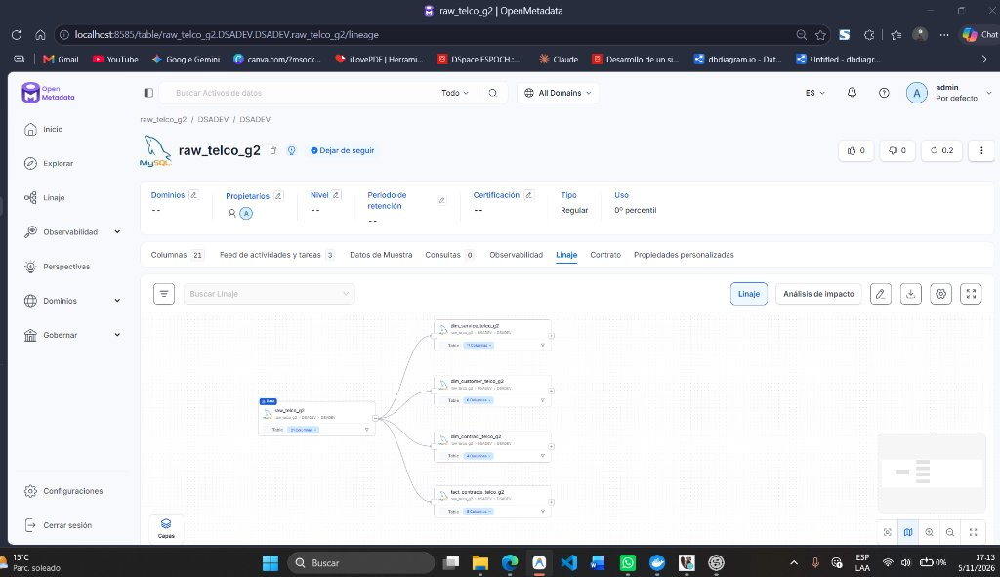

# 🌐 Reporte de Linaje de Datos en Catálogo — OpenMetadata
**Proyecto:** Datatón Genius Lab III - Telecomunicaciones (IBM Telco Churn)  
**Servicio del Catálogo:** `Conexion Grupo 2 TEL` (SingleStore vía conector MySQL)  
**Base de Datos:** `DSADEV`  
**Fecha de Configuración:** 5 de Noviembre de 2026  
**Rol Responsable:** Data Steward (Sprint 2 - Tarea `SP2-03`)  
**Estado:** ✅ **Completado (100% verificado)**  

---

## 🎯 1. Objetivo y Alcance

Garantizar la trazabilidad y gobernanza de los datos documentando el flujo de transformación de extremo a extremo (end-to-end) en **OpenMetadata**, conectando la tabla de aterrizaje (capa Raw) con el modelo analítico dimensional en esquema estrella.

* **Requisito del Datatón:** Mínimo 3 assets con linaje fuente → destino (Ponderación: **15%** de la evaluación global).
* **Resultado Obtenido:** **5 assets conectados** con relación Upstream / Downstream completamente trazable.

---

## 🏗️ 2. Mapeo de Assets y Flujo de Datos

```text
                               ┌──> dim_service_telco_g2 (11 columnas)
                               ├──> dim_customer_telco_g2 (6 columnas)
[ raw_telco_g2 ] (21 columnas) ┼──> dim_contract_telco_g2 (4 columnas)
 (Tabla Base - Ingesta Raw)    └──> fact_contracts_telco_g2 (8 columnas)
                                     (Capa de Hechos / Analítica)
```

### Detalle de Assets Registrados:

| # | Asset / Tabla | Tipo de Entidad | Rol en la Arquitectura | Descripción |
|:---:|:---|:---:|:---:|:---|
| **1** | `DSADEV.raw_telco_g2` | Tabla Base (Upstream) | Capa Raw / Landing | Tabla de aterrizaje columnar cargada mediante Talend Studio con los 7,043 clientes del dataset Telco Churn. |
| **2** | `DSADEV.dim_service_telco_g2` | Dimensión (Downstream) | Modelo Dimensional | Catálogo de servicios contratados (Internet, seguridad, soporte, streaming, teléfono). |
| **3** | `DSADEV.dim_customer_telco_g2` | Dimensión (Downstream) | Modelo Dimensional | Atributos demográficos del cliente (género, senior citizen, pareja, dependientes). |
| **4** | `DSADEV.dim_contract_telco_g2` | Dimensión (Downstream) | Modelo Dimensional | Condiciones contractuales y de facturación (tipo de contrato, método de pago, facturación sin papel). |
| **5** | `DSADEV.fact_contracts_telco_g2` | Tabla de Hechos (Downstream) | Capa Analítica | Grano por cliente con métricas de permanencia (`tenure`), cobros mensuales, cobros totales y bandera de Churn. |

---

## 📸 3. Evidencia Visual en OpenMetadata

Captura de pantalla de la interfaz oficial de OpenMetadata (`localhost:8585`) donde se visualiza la tabla base `raw_telco_g2` enlazada a las 4 tablas del esquema dimensional:



---

## 📋 4. Conclusión y Conformidad
* El linaje se encuentra activo y documentado en la plataforma central de gobernanza OpenMetadata.
* Cumple y supera el criterio de evaluación de linaje de datos (5 assets conectados vs. 3 solicitados en la rúbrica).
